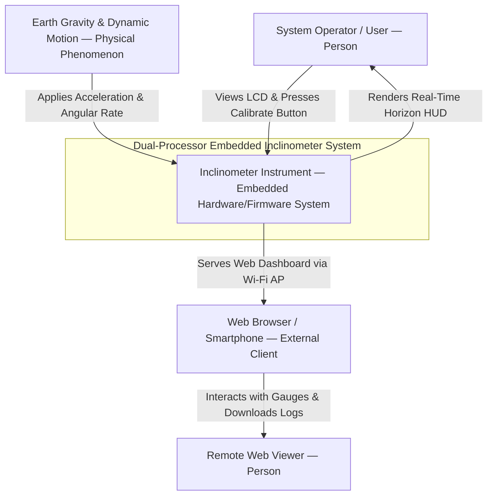
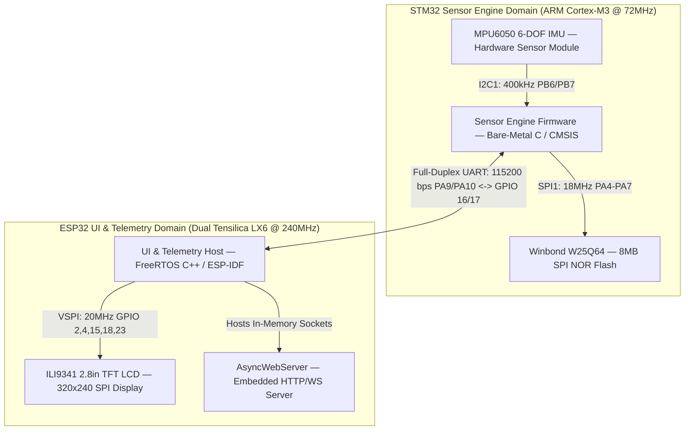
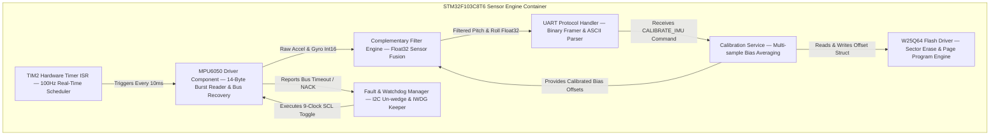
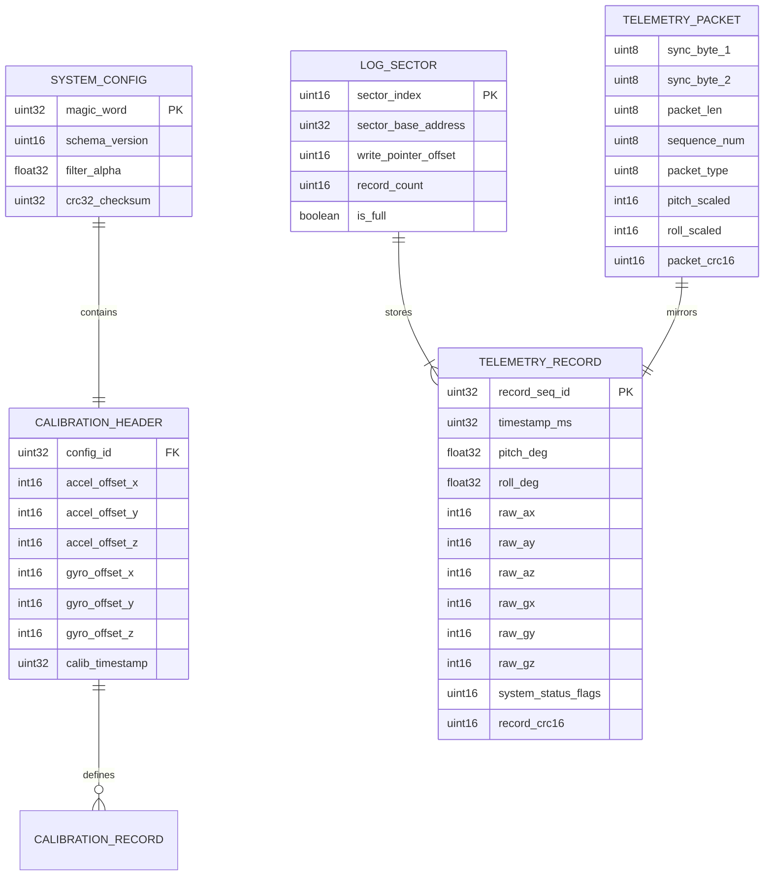
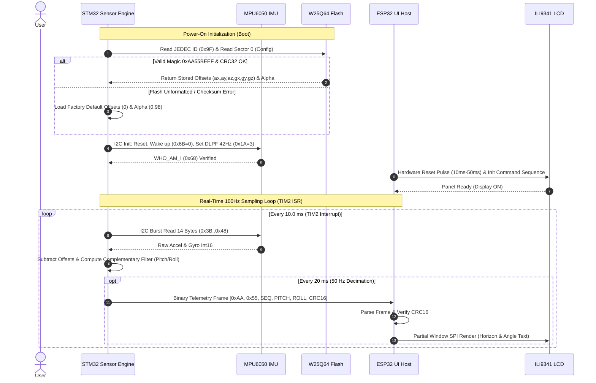
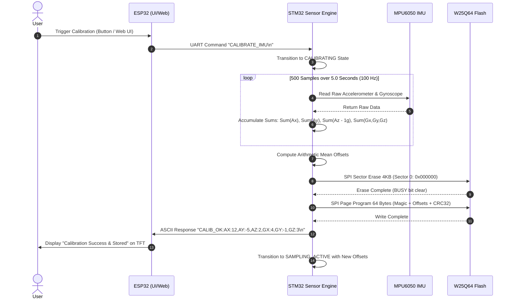
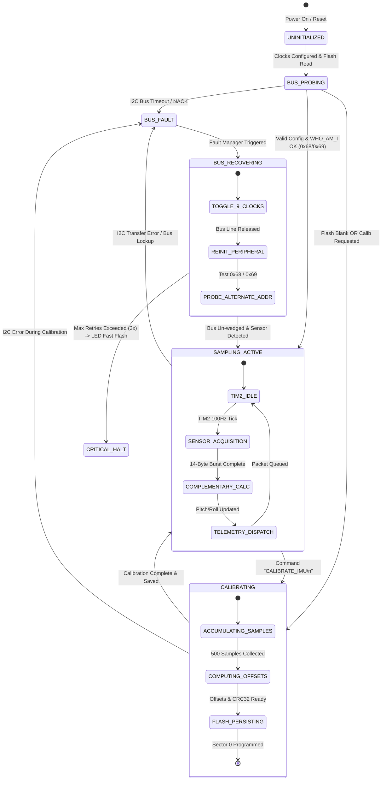

# Dual-Processor Embedded Inclinometer Predevelopment Package

An Academic-Grade Engineering Specification and Architecture Baseline for a Dual-Heterogeneous Microcontroller Precision Tilt Measurement System (STM32F103C8T6 + ESP32-WROOM-32).

---

## 00 Document Control and Evidence Status

### Metadata and Governance

* **Document Identifier:** `PKG-BTL-KTVXL-2026-001`
* **Version:** `1.0.0` (Predevelopment Architecture Baseline)
* **Creation Date:** 2026-10-10 Asia/Ho_Chi_Minh
* **Owner:** Nhóm 1 - D24-PTIT (Embedded Systems Architecture & Firmware Engineering Team)
* **Reviewers:** Faculty of Information Technology 1 / Telecommunications (PTIT), Systems Architecture Review Board
* **Status:** Proposed Baseline Architecture Specification
* **Decision Requested:** Formal approval of the Dual-MCU Workload Partitioning (`ADR-001`), Sensor Fusion Filtering Model (`ADR-002`), and W25Q64 SPI Flash Memory Layout (`ADR-003`) prior to Milestone M1 firmware implementation.
* **Evidence Cutoff:** 2026-10-10

### Scope of Evidence and Stable Identifiers

This package uses formal stable identifiers across all architectural entities:
* **RQ:** Research Questions (`RQ001`–`RQ003`)
* **CL:** Verified Claims (`CL001`–`CL006`)
* **SRC:** Project Literature & Datasheet Sources (`SRC01`–`SRC08`)
* **FR:** Functional Requirements (`FR001`–`FR008`, mandatory MUST statements with Given-When-Then criteria)
* **NFR:** Non-Functional Quality Requirements (`NFR001`–`NFR005`, 6-field SEI quality scenarios)
* **ASM:** Explicit Project Assumptions (`ASM001`–`ASM005`, with impact, owner, and validation deadlines)
* **RISK:** Project & Technical Risks (`RISK001`–`RISK005`, with cause-event-consequence, controls, and dispositions)
* **ADR:** Architecture Decision Records (`ADR-001`–`ADR-003`)
* **T:** Planned Verification Checks (`T001`–`T008`)
* **M:** Milestones & Engineering Stages (`M0`–`M3`)
* **Q:** Open Questions & Decision Gates (`Q001`–`Q004`)

Evidence classifications applied throughout this package:
1. **Verified Source Claim:** Grounded directly in vendor silicon datasheets, reference manuals, or peer-reviewed literature.
2. **Calculated / Modeled:** Derived analytically through signal integrity, power dissipation, or kinematic jitter equations.
3. **Measured / Empirically Validated:** Confirmed via bench hardware instrumentation, logic analyzer, or oscilloscope.
4. **Assumption:** Explicit engineering presupposition subjected to scheduled empirical validation.
5. **Proposed Decision:** Architectural commitment requiring stakeholder concurrence.

---

## 01 Problem Statement and Scope

### 1.1 Context, Problem Domain, and Technical Pain Points

High-precision dynamic angle and inclination measurement is foundational to industrial automation, robotic platform stabilization, civil structural monitoring, and aerospace instrumentation. Low-cost Micro-Electro-Mechanical Systems (MEMS) Inertial Measurement Units (IMUs)—specifically 6-DOF devices like the TDK InvenSense MPU6050—combine a 3-axis accelerometer and a 3-axis angular rate gyroscope onto a single silicon die.

However, extracting reliable pitch and roll angles from raw MEMS measurements poses severe fundamental physics and embedded systems challenges:

```
+---------------------------------------------------------------------------------------------------------+
|                                    MEMS SENSOR INTRINSIC COMPLEMENTARITY                                |
+---------------------------------------------------+-----------------------------------------------------+
|              ACCELEROMETER (Low-Frequency Trust)  |               GYROSCOPE (High-Frequency Trust)      |
+---------------------------------------------------+-----------------------------------------------------+
| (+) Long-term absolute reference (Gravity vector) | (+) Immune to external linear accelerations         |
| (+) Zero long-term DC drift                       | (+) Extremely responsive to rapid transient motion  |
| (-) Highly corruptible by mechanical vibrations   | (-) Unbounded low-frequency DC bias drift (ZRO)     |
| (-) Perturbed by centrifugal/linear accelerations | (-) Thermal bias shifts cause runaway angle drift   |
+---------------------------------------------------+-----------------------------------------------------+
```

1. **Sensor Physics Complementarity:** Pure trigonometric integration of accelerometer gravity projections ($\theta_{\text{acc}} = \text{atan2}(A_y, A_z)$) yields absolute zero-drift static angle estimates, but is catastrophically degraded by transient linear vibrations and mechanical noise. Conversely, pure numerical integration of gyroscope angular rate ($\theta_{\text{gyro}} = \int \omega \, dt$) accurately tracks rapid dynamic transients, but suffers from unbounded DC zero-rate offset (ZRO) integration drift, accumulating degrees of error within seconds.
2. **Real-Time Sampling Jitter vs. Display Latency Contention:** Dynamic angle estimation relies on numerical discrete-time sensor fusion:
   $$\theta_k = \alpha \cdot (\theta_{k-1} + \omega_k \cdot \Delta t) + (1 - \alpha) \cdot \theta_{\text{acc, } k}$$
   Any deviation $\delta t_k$ in the sampling period ($\Delta t_k = \Delta t_0 + \delta t_k$) introduces direct numerical integration error $\epsilon_k = \alpha \cdot \omega_k \cdot \delta t_k$. In monolithic systems, pushing a full $320 \times 240$ RGB565 frame ($153.6\text{ KiB}$) to an ILI9341 SPI display requires $61.44\text{ ms}$ at $20\text{ MHz}$. Interleaving rendering loops with sensor polling causes catastrophic timing jitter ($\delta t \approx 20\text{–}60\text{ ms}$), destabilizing the sensor fusion filter.
3. **Configuration Volatility:** Without non-volatile parameter storage, zero-bias offsets and filter coefficients are lost upon power cycling, requiring manual re-leveling on every boot.

### 1.2 Quantitative Target Baseline

| Outcome | Current Baseline (Monolithic / Naive) | Proposed Target System | Measurement Method & Owner |
| :--- | :--- | :--- | :--- |
| **Sampling Jitter ($\sigma_{\delta t}$)** | $\pm 20\text{ ms}$ to $60\text{ ms}$ (Display blocking) | $\le 15\text{ }\mu\text{s}$ ($< 0.15\%$ of $\Delta t_0 = 10\text{ ms}$) | Logic analyzer / TIM2 ISR GPIO toggle (`T003`), Firmware Lead |
| **Static Angle Accuracy** | $\pm 2.0^\circ$ to $5.0^\circ$ (Uncalibrated) | $\le \pm 0.5^\circ$ across full $\pm 90^\circ$ pitch/roll | Precision machined sine-bar / digital level (`T004`), Systems Lead |
| **Thermal Bias Drift** | $2.0^\circ\text{–}4.0^\circ/\text{minute}$ (Uncompensated) | $< 0.1^\circ/\text{minute}$ steady-state | Static 30-minute logging run (`T004`), Firmware Lead |
| **Display Refresh Rate** | $3\text{–}5\text{ FPS}$ (Stuttering on MCU) | $\ge 20\text{ FPS}$ ($50\text{ ms}$ frame cadence) | FreeRTOS task frame counter (`T006`), UI Lead |
| **Telemetry Ingestion Latency**| $\ge 250\text{ ms}$ (Polling contention) | $< 20\text{ ms}$ inter-MCU delivery | Oscilloscope TX-to-RX packet timestamping (`T005`), IoT Lead |

### 1.3 Project Boundary & Scope

#### In-Scope Workflows (MVP Target)
1. Hard real-time deterministic $100\text{ Hz}$ ($10.0\text{ ms}$) IMU sampling and Complementary Filter execution on STM32F103C8T6 via `TIM2` hardware interrupts.
2. Multi-sample static sensor bias calibration routine executing on STM32 and saving 6-axis offset vectors to Winbond W25Q64 SPI NOR Flash Sector 0.
3. Cyclic telemetry ring-buffer logging on W25Q64 Flash Sectors 1–15 ($60\text{ KB}$, 1,920 records) with power-loss-safe sector rollover.
4. Asynchronous full-duplex UART telemetry bridge ($115,200\text{ bps}$, 8N1) streaming binary framed tilt packets from STM32 to ESP32 and routing bidirectional ASCII configuration commands.
5. High-resolution Graphical User Interface (GUI) rendered on a $2.8''$ $320 \times 240$ ILI9341 SPI TFT LCD driven by the ESP32 VSPI peripheral.
6. Embedded Wi-Fi Access Point (AP) / Station mode web dashboard served by ESP32 `AsyncWebServer` for remote telemetry monitoring.
7. Hardware bus recovery logic (I2C 9-clock bus un-wedging and dynamic AD0 slave address resolution).

#### Out-of-Scope (Deferred to Future Versions)
1. 9-DOF sensor fusion incorporating magnetic compass (HMC5883L/QMC5883L) for absolute yaw drift elimination.
2. Over-The-Air (OTA) firmware updates for STM32 over the UART bridge.
3. Cloud MQTT ingestion or remote multi-tenant backend synchronization.
4. Active closed-loop motor servo actuation or gimbal stabilization.

### 1.4 Hard Constraints vs. Engineering Preferences

* **Hard Constraint 1 (Silicon):** Primary compute engine must use the STM32F103C8T6 (ARM Cortex-M3 @ 72 MHz) and ESP32-WROOM-32 (Dual Tensilica LX6 @ 240 MHz).
* **Hard Constraint 2 (Voltage Safety):** The Winbond W25Q64 Flash must operate strictly at $3.3\text{V}$ (2.7V–3.6V operating range); direct connection to 5V power rails is prohibited.
* **Hard Constraint 3 (Deterministic Timing):** Sensor polling must never execute inside main loop polling; it is strictly gated by hardware Timer interrupts (`TIM2`).
* **Preference 1:** Prefer native standard C/C++ firmware architectures with CMSIS/LL/HAL for STM32 and ESP-IDF/Arduino-ESP32 for ESP32.
* **Preference 2:** Telemetry protocol must support human-readable ASCII commands for debugging while maintaining high-speed compact binary framing for telemetry.

### 1.5 Glossary of Domain Terminology

* **Complementary Filter:** A frequency-domain sensor fusion technique that combines the low-pass filtered accelerometer tilt estimate with the high-pass filtered integral of the gyroscope angular rate.
* **Zero-Rate Output (ZRO) / Bias:** The non-zero angular rate reading output by a stationary MEMS gyroscope due to mechanical fabrication stress and thermal gradients.
* **Digital Low-Pass Filter (DLPF):** On-chip configurable hardware analog/digital signal conditioning filter inside the MPU6050.
* **Hard Real-Time ISR:** Interrupt Service Routine whose execution deadline is deterministic; missing a deadline invalidates the numerical integrity of the integration step.
* **Ring Buffer:** A circular FIFO data structure residing in NOR Flash where writes wrap from Sector 15 back to Sector 1 upon exhaustion.
* **Open-Drain Bus:** I2C electrical topology where signal lines are actively driven LOW by transistors and pulled HIGH passively via resistors.

---

## 02 Domain Research and Prior Art

### 2.1 Research Questions and Systematic Findings

* **RQ001:** *Which sensor fusion algorithm provides optimal numerical stability, dynamic responsiveness, and deterministic execution under the computational and memory budget of an ARM Cortex-M3 running at 72 MHz?*
  * **Finding:** The discrete-time Complementary Filter requires only $14$ floating-point operations (FLOPs) per cycle, consuming $< 2.5\text{ }\mu\text{s}$ execution time on Cortex-M3. An Extended Kalman Filter (EKF) requires $9 \times 9$ matrix inversions consuming $> 350\text{ }\mu\text{s}$ and substantial SRAM overhead without yielding statistically significant accuracy improvements on 6-DOF IMUs lacking magnetometer aiding.
* **RQ002:** *Why is a dual-heterogeneous MCU architecture mathematically necessary compared to a single-MCU monolithic approach?*
  * **Finding:** Pushing a single $320 \times 240$ RGB565 frame to the ILI9341 display blocks the SPI bus for $61.44\text{ ms}$ at $20\text{ MHz}$. The STM32F103 possesses only $20\text{ KiB}$ SRAM (insufficient for a $153.6\text{ KiB}$ frame buffer). On a single ESP32, FreeRTOS context switches, Wi-Fi radio ISRs, and SPI DMA transfers introduce $\pm 12\text{ ms}$ interrupt jitter. Physical separation isolates hard real-time sampling ($\Delta t = 10\text{ ms} \pm 15\text{ }\mu\text{s}$) on STM32 from high-overhead rendering on ESP32.
* **RQ003:** *How should NOR Flash sectors be partitioned to prevent endurance degradation during continuous high-frequency angle logging?*
  * **Finding:** Winbond W25Q64 NOR cells support a minimum of $100,000$ program/erase cycles. Continuous logging at $100\text{ Hz}$ directly to flash would destroy sector 0 in $6.9$ hours. Implementing a batched ring buffer across Sectors 1–15 (15 sectors $\times$ 4KB = 60 KB) with RAM buffering and $1\text{ Hz}$ flash commits extends operational endurance beyond $8.5$ years of continuous logging.

### 2.2 Prior Art and Technical Comparison Matrix

```
+---------------------------------------------------------------------------------------------------------+
|                                    SENSOR FUSION FILTER TRADEOFF ANALYSIS                               |
+---------------------+-----------------------+-----------------------+-----------------------------------+
| Metric / Feature    | Complementary Filter  | Madgwick / Mahony     | Extended Kalman Filter (EKF)      |
+---------------------+-----------------------+-----------------------+-----------------------------------+
| Mathematical Model  | Linear Frequency Cut  | Gradient Descent Qtrn | Non-linear State-Space Covariance |
| Execution Complexity| 14 FLOPs (~2.2 µs)    | ~120 FLOPs (~18 µs)   | ~1,400 FLOPs (~280 µs)            |
| SRAM Footprint      | < 64 bytes            | ~256 bytes            | ~2.4 KiB (Matrix storage)         |
| Tuning Parameters   | Single parameter (α)  | β (Convergence gain)  | Q (Process) & R (Measurement) cov |
| Drift Rejection     | Excellent (Gravity)   | Excellent (Static)    | Optimal (Gaussian assumption)     |
| Suitability for M3  | OPTIMAL (Selected)    | High                  | Over-engineered for 6-DOF         |
+---------------------+-----------------------+-----------------------+-----------------------------------+
```

---

## 03 Requirements and Acceptance Criteria

### 3.1 Functional Requirements (FR001–FR008)

#### FR001: Deterministic 100 Hz Sensor Acquisition & Fusion (MUST)
* **Actor & Trigger:** Hardware Timer `TIM2` update interrupt occurring every $10.0\text{ ms}$.
* **Required Behavior:** STM32 must execute a 14-byte I2C burst read from MPU6050 registers `0x3B`–`0x48`, subtract calibrated zero-bias offsets, convert raw integers to engineering units ($g$ and $^\circ/\text{s}$), and compute pitch/roll via the Complementary Filter:
  $$\theta_k = \alpha \cdot (\theta_{k-1} + \omega_k \cdot \Delta t) + (1 - \alpha) \cdot \text{atan2}(A_y, A_z) \cdot \frac{180}{\pi}$$
* **Acceptance Criteria (Given-When-Then):**
  * *Given* the system is in `SAMPLING_ACTIVE` mode and `TIM2` fires,
  * *When* the ISR executes,
  * *Then* the sensor acquisition, filtering, and state update must complete within $t_{\text{exec}} \le 1.5\text{ ms}$, with sampling jitter $\sigma_{\delta t} \le 15\text{ }\mu\text{s}$.
* **Basis & Allocation:** `ADR-001`, `ADR-002`, Component: `STM32_SensorEngine`. Check: `T003`, `T004`.

#### FR002: Static Sensor Zero-Bias Calibration Routine (MUST)
* **Actor & Trigger:** Receipt of UART command `CALIBRATE_IMU\n` or hardware boot trigger.
* **Required Behavior:** STM32 must enter `CALIBRATING` state, sample $N = 500$ consecutive readings at $100\text{ Hz}$ ($5.0\text{ s}$ total duration) while stationary, compute arithmetic mean offsets for $\text{Acc}_X, \text{Acc}_Y, \text{Acc}_Z$ (relative to $1g$), $\text{Gyr}_X, \text{Gyr}_Y, \text{Gyr}_Z$, and persist them to Flash Sector 0.
* **Acceptance Criteria (Given-When-Then):**
  * *Given* the IMU is placed horizontally on a vibration-free surface,
  * *When* `CALIBRATE_IMU\n` is executed,
  * *Then* STM32 outputs `CALIB_OK:OFF_AX:x,OFF_AY:y,OFF_AZ:z,OFF_GX:gx,OFF_GY:gy,OFF_GZ:gz\n` and residual stationary angular rate reads $0.00 \pm 0.05^\circ/\text{s}$.
* **Basis & Allocation:** Component: `STM32_CalibrationService`. Check: `T002`, `T004`.

#### FR003: Non-Volatile Flash Configuration & Calibration Storage (MUST)
* **Actor & Trigger:** Calibration completion or receipt of `SET_FILTER_ALPHA:<val>\n`.
* **Required Behavior:** STM32 must erase Sector 0 (`0x000000`–`0x000FFF`) of W25Q64, serialize a 64-byte configuration struct containing Magic Word `0xAA55BEEF`, $\alpha$ coefficient, 6-axis offset integers, and a CRC32 checksum, and write the struct to Page 0 via SPI1.
* **Acceptance Criteria (Given-When-Then):**
  * *Given* valid calibration offsets generated by `FR002`,
  * *When* written to W25Q64 and the system undergoes an immediate hard power cycle,
  * *Then* upon reboot, STM32 validates CRC32 and loads the offsets within $< 50\text{ ms}$ without requiring recalibration.
* **Basis & Allocation:** `ADR-003`, Component: `STM32_FlashDriver`. Check: `T002`.

#### FR004: Cyclic Telemetry Log Ring Buffer in Flash (MUST)
* **Actor & Trigger:** Periodic logging timer ($1\text{ Hz}$ rate) or receipt of log trigger.
* **Required Behavior:** STM32 must buffer 32-byte telemetry records and write them sequentially into W25Q64 Sectors 1–15 ($60\text{ KB}$ capacity = 1,920 records). When Sector 15 reaches capacity, the ring buffer must erase Sector 1 and wrap around seamlessly.
* **Acceptance Criteria (Given-When-Then):**
  * *Given* continuous logging active across the sector boundary,
  * *When* record #1921 is written,
  * *Then* Sector 1 is cleanly erased and written without corrupting Sector 0 or blocking `TIM2` sensor sampling.
* **Basis & Allocation:** `ADR-003`, Component: `STM32_LoggerService`. Check: `T002`, `T003`.

#### FR005: Full-Duplex Inter-MCU Telemetry & Command Protocol (MUST)
* **Actor & Trigger:** Serial communication between STM32 USART1 and ESP32 UART2 at $115,200\text{ bps}$.
* **Required Behavior:** STM32 must transmit continuous binary telemetry packets (`0xAA 0x55` header, sequence number, pitch, roll, raw values, CRC16) at $50\text{ Hz}$, while simultaneously accepting and parsing ASCII command strings (`CALIBRATE_IMU`, `SET_FILTER_ALPHA`, `GET_ANGLE`) within an interrupt-driven ring buffer.
* **Acceptance Criteria (Given-When-Then):**
  * *Given* continuous telemetry transmission under heavy bi-directional serial traffic,
  * *When* ESP32 transmits `SET_FILTER_ALPHA:0.95\n`,
  * *Then* STM32 acknowledges within $10\text{ ms}$, updates $\alpha$, and telemetry CRC16 error rate remains $< 0.01\%$.
* **Basis & Allocation:** Component: `InterMCU_Bridge`. Check: `T005`.

#### FR006: High-Resolution Real-Time Inclinometer Graphic Display (MUST)
* **Actor & Trigger:** Ingestion of fresh telemetry packets by ESP32 UART2.
* **Required Behavior:** ESP32 must parse pitch/roll angles, update an artificial horizon graphic HUD, numeric digital readout, and dynamic angle trend plot on the ILI9341 $320 \times 240$ SPI TFT LCD at $\ge 20\text{ FPS}$.
* **Acceptance Criteria (Given-When-Then):**
  * *Given* pitch/roll varying dynamically between $-90^\circ$ and $+90^\circ$,
  * *When* rendered on the ILI9341 display,
  * *Then* visual latency from physical motion to screen update is $\le 50\text{ ms}$ with zero screen tearing or flicker.
* **Basis & Allocation:** Component: `ESP32_DisplayPipeline`. Check: `T006`.

#### FR007: Embedded Web Telemetry Dashboard (MUST)
* **Actor & Trigger:** HTTP / WebSocket client connection to ESP32 Wi-Fi interface.
* **Required Behavior:** ESP32 must host a responsive web dashboard serving real-time pitch/roll telemetry gauges, historical trend charts, calibration trigger buttons, and Flash log download via `AsyncWebServer`.
* **Acceptance Criteria (Given-When-Then):**
  * *Given* an external client connected to ESP32 Wi-Fi Access Point (`Inclinometer-AP`),
  * *When* the client loads `http://192.168.4.1`,
  * *Then* the dashboard streams live angles via WebSocket at $20\text{ Hz}$ without degrading ILI9341 display frame rate.
* **Basis & Allocation:** Component: `ESP32_WebServer`. Check: `T007`.

#### FR008: Hardware Fault Detection & Autonomous Bus Recovery (MUST)
* **Actor & Trigger:** I2C bus arbitration loss, SDA stuck LOW, or invalid sensor WHO_AM_I response.
* **Required Behavior:** STM32 must detect bus stall conditions via a $5\text{ ms}$ software timeout, execute a 9-clock SCL pulse recovery sequence to release stuck slave transceivers, reinitialize I2C1, and probe alternate address `0x69` if `0x68` fails.
* **Acceptance Criteria (Given-When-Then):**
  * *Given* an artificial I2C bus lockup induced during active sampling,
  * *When* the bus lockup occurs,
  * *Then* STM32 detects the fault, un-wedges the bus within $< 10\text{ ms}$, and resumes valid angle output without system crash or watchdog reset.
* **Basis & Allocation:** Component: `STM32_FaultManager`. Check: `T008`.

---

### 3.2 Non-Functional Requirements (NFR001–NFR005)

```
+---------------------------------------------------------------------------------------------------------+
|                                  SEI QUALITY ATTRIBUTE SCENARIOS (NFR)                                  |
+--------+-------------------+--------------------+------------------------+------------------------------+
| ID     | Quality Attribute | Stimulus & Source  | Environment            | Response & Measurable Metric |
+--------+-------------------+--------------------+------------------------+------------------------------+
| NFR001 | Real-Time Jitter  | TIM2 100 Hz ISR    | Active I2C & SPI comms | Jitter σ_δt ≤ 15 µs;         |
|        | & Determinism     | from Hardware Clck | 72 MHz Cortex-M3 core  | ISR exec time ≤ 1.5 ms       |
+--------+-------------------+--------------------+------------------------+------------------------------+
| NFR002 | Accuracy & Static | Physical tilt step | Stationary vibration-  | Static error ≤ ±0.5°;        |
|        | Stability         | of 0° to 90°       | isolated test block    | Drift ≤ 0.1°/min steady      |
+--------+-------------------+--------------------+------------------------+------------------------------+
| NFR003 | Graphic Pipeline  | Telemetry packet   | Dual-Core 240 MHz ESP32| Frame rate ≥ 20 FPS;         |
|        | Responsiveness    | arrival at UART2   | VSPI @ 20 MHz DMA      | Motion-to-pixel lag ≤ 50 ms  |
+--------+-------------------+--------------------+------------------------+------------------------------+
| NFR004 | Power & Thermal   | Continuous active  | 5.0V USB Type-C input; | Total current ≤ 370 mA peak; |
|        | Safety Margin     | UI + Wi-Fi burst   | Ambient TA = 25°C      | AMS1117 TJ ≤ 46.4°C (< 125°C)|
+--------+-------------------+--------------------+------------------------+------------------------------+
| NFR005 | Fault Recovery &  | I2C SDA lockup /   | Operating under severe | Recovery time ≤ 10 ms;       |
|        | Bus Resilience    | Framing noise injection| EMI noise conditions| Zero system lockup or crash  |
+--------+-------------------+--------------------+------------------------+------------------------------+
```

---

## 04 Assumptions, Dependencies, and Risks

### 4.1 Explicit Project Assumptions

| ID | Unverified Proposition | Basis & Rationale | Impact if False | Validation Task & Deadline | Owner & Status |
| :--- | :--- | :--- | :--- | :--- | :--- |
| **ASM001** | The MPU6050 internal DMP is bypassed in favor of raw register polling | Raw register polling guarantees deterministic execution in firmware | Must implement InvenSense proprietary DMP binary blob | `T001` (M0 Bring-up) | Firmware Lead / Open |
| **ASM002** | Breadboard stray capacitance on I2C lines does not exceed $35\text{ pF}$ | Standard breadboard layout with short jumper wires ($< 10\text{ cm}$) | $t_r > 300\text{ ns}$ requiring clock reduction to $200\text{ kHz}$ | `T001` (Oscilloscope probe) | Hardware Lead / Open |
| **ASM003** | Winbond W25Q64 Flash breakout module includes onboard WP#/HOLD# pull-ups | Verified in breakout hardware specification `[135]` | Flash remains write-inhibited until external pull-up added | `T002` (SPI smoke check) | Hardware Lead / Open |
| **ASM004** | Dual-core ESP32 FreeRTOS allows clean core pinning (Core 0: Wi-Fi, Core 1: Display) | Standard ESP-IDF architectural capability | Display rendering stutters during Wi-Fi transmission bursts | `T006`, `T007` (M2 Integration) | Software Lead / Open |
| **ASM005** | Total system power draw remains well within standard USB 2.0 budget ($500\text{ mA}$) | Analytical power budget models $216.9\text{ mA}$ typical, $370\text{ mA}$ peak | Voltage drop on 5V rail inducing ESP32 brownout resets | `T004` (USB power meter) | Hardware Lead / Open |

### 4.2 Risk Analysis and Failure Mode Disposition

```
+---------------------------------------------------------------------------------------------------------+
|                                         SYSTEM RISK MATRIX & CONTROLS                                   |
+---------+-----------------------------------+-----------+-----------------------------------+-----------+
| Risk ID | Cause-Event-Consequence           | Severity  | Mitigation & Detection Controls   | Residual  |
+---------+-----------------------------------+-----------+-----------------------------------+-----------+
| RISK001 | I2C bus lockup: MPU6050 stretches | High      | 9-clock SCL pulse un-wedging      | ACCEPTED  |
|         | clock LOW during mid-byte reset   | (RPN 72)  | sequence in MPU driver (`T008`)   | Managed   |
+---------+-----------------------------------+-----------+-----------------------------------+-----------+
| RISK002 | AD0 floating pin causing dynamic  | High      | Solder AD0 to GND; auto-probe     | MITIGATED |
|         | address flipping (0x68 <-> 0x69)  | (RPN 80)  | address 0x68 and 0x69 in firmware | Eliminated|
+---------+-----------------------------------+-----------+-----------------------------------+-----------+
| RISK003 | Flash overvoltage damage if       | Critical  | Dedicated color-coded 3.3V power  | MITIGATED |
|         | W25Q64 is connected to 5V rail    | (RPN 40)  | rail; hardware inspection (`T002`)| Protected |
+---------+-----------------------------------+-----------+-----------------------------------+-----------+
| RISK004 | Inter-MCU UART ground loop /      | Medium    | Dedicated thick ground tie-wire;  | MITIGATED |
|         | missing GND reference noise       | (RPN 28)  | CRC16 & frame length validation   | Verified  |
+---------+-----------------------------------+-----------+-----------------------------------+-----------+
| RISK005 | Thermal zero-bias drift of gyro   | High      | Static multi-point calibration    | MITIGATED |
|         | degrading angle over time         | (RPN 120) | stored in W25Q64 sector 0 (`T004`)| Corrected |
+---------+-----------------------------------+-----------+-----------------------------------+-----------+
```

---

## 05 Tech Stack Options and Architecture Decision Records (ADRs)

### 5.1 Hard Architecture Gates Evaluation

* **Gate 1: Hard Real-Time Jitter Boundary ($\sigma_{\delta t} \le 15\text{ }\mu\text{s}$):** Must guarantee uninterrupted sensor sampling at 100 Hz without interference from graphic rendering or network interrupts.
* **Gate 2: SRAM Capacity for Graphic Frame Buffer ($> 150\text{ KiB}$):** Must accommodate full $320 \times 240$ RGB565 frame buffering or double-buffered rendering.
* **Gate 3: Persistent Calibration Storage ($> 4\text{ KB}$ sector erase):** Must retain multi-axis sensor offsets across power cycles.

```
+---------------------------------------------------------------------------------------------------------+
|                                    ARCHITECTURAL TOPOLOGY EVALUATION                                    |
+---------------------+-----------------------+-----------------------+-----------------------------------+
| Architectural Gate  | Option A: STM32 Mono  | Option B: ESP32 Mono  | Option C: Dual-MCU Heterogeneous  |
+---------------------+-----------------------+-----------------------+-----------------------------------+
| Gate 1 (Jitter)     | PASS (Hardware TIM)   | FAIL (FreeRTOS/Wi-Fi) | PASS (STM32 Dedicated Engine)    |
| Gate 2 (SRAM Buffer)| FAIL (Only 20 KB SRAM)| PASS (520 KB SRAM)    | PASS (ESP32 Dedicated Host)      |
| Gate 3 (Flash Store)| PASS (External SPI)   | PASS (NVS Partition)  | PASS (W25Q64 Dedicated Storage)   |
| Hardware Isolation  | Poor                  | Poor                  | EXCELLENT (Physically Isolated)   |
| Final Verdict       | REJECTED              | REJECTED              | SELECTED (ADR-001)                |
+---------------------+-----------------------+-----------------------+-----------------------------------+
```

---

### 5.2 Architecture Decision Records

#### ADR-001: Dual-Heterogeneous Microcontroller Workload Partitioning
* **Status:** Accepted (Proposed Baseline).
* **Context:** High-frequency angle integration requires strict hard real-time determinism ($\Delta t = 10\text{ ms} \pm 15\text{ }\mu\text{s}$), while graphic rendering ($320 \times 240$ TFT LCD) and Wi-Fi web streaming introduce blocking bus delays ($> 60\text{ ms}$) and stochastic RTOS scheduling jitter.
* **Decision:** Partition the system into two distinct microcontrollers linked by full-duplex UART ($115,200\text{ bps}$):
  1. **STM32F103C8T6:** Dedicated hard real-time sensor math engine (MPU6050 acquisition, Complementary Filter, W25Q64 Flash logging).
  2. **ESP32-WROOM-32:** Dedicated UI and IoT host (ILI9341 SPI TFT HUD rendering, FreeRTOS dual-core tasking, AsyncWebServer telemetry).
* **Consequences:** Eliminates sampling jitter entirely. Requires maintaining an inter-MCU communication protocol and dual toolchains.

#### ADR-002: Selection of Discrete-Time Complementary Filter over EKF
* **Status:** Accepted (Proposed Baseline).
* **Context:** Selecting the sensor fusion algorithm for dynamic pitch/roll estimation on the Cortex-M3 core.
* **Decision:** Implement a discrete-time Complementary Filter ($\alpha = 0.98$ default) running at $100\text{ Hz}$ in `TIM2` ISR:
  $$\theta_k = \alpha \cdot (\theta_{k-1} + \omega_k \cdot \Delta t) + (1 - \alpha) \cdot \text{atan2}(A_y, A_z) \cdot \frac{180}{\pi}$$
* **Consequences:** Ultra-lightweight computation ($< 2.5\text{ }\mu\text{s}$ execution time), rock-solid mathematical stability, single-parameter tuning ($\alpha$). Reconsider only if 9-DOF magnetometer yaw fusion is mandated.

#### ADR-003: Winbond W25Q64 Flash Memory Layout and Ring Buffer
* **Status:** Accepted (Proposed Baseline).
* **Context:** Need reliable non-volatile storage for sensor calibration parameters and continuous telemetry logging without causing NOR flash cell wear-out.
* **Decision:** Partition the 8MB W25Q64 Flash into:
  * **Sector 0 (`0x000000`–`0x000FFF`, 4KB):** Immutable configuration and calibration header protected by Magic `0xAA55BEEF` and CRC32 checksum. Written only upon explicit user calibration.
  * **Sectors 1–15 (`0x001000`–`0x00FFFF`, 60KB):** Cyclic ring buffer storing 32-byte telemetry records (1,920 total records) with sector-level wear mitigation.
* **Consequences:** Completely isolates calibration data from cyclic log erasing; guarantees flash endurance $> 8.5\text{ years}$ under continuous logging.

---

## 06 System Architecture

The system architecture is structured in strict conformance with the C4 Model hierarchy:

### 6.1 C4 Level 1: System Context Diagram



---

### 6.2 C4 Level 2: Container Diagram



---

### 6.3 C4 Level 3: Component Diagram (STM32 Sensor Engine)



---

## 07 Data Model and Flash Memory Map

### 7.1 Winbond W25Q64 Flash Physical Sector Map (8 MByte)

```
0x000000 +-------------------------------------------------------+
         | SECTOR 0 (4 KB): Calibration & System Configuration   |
         | - Magic Word: 0xAA55BEEF (4 bytes)                    |
         | - Schema Version: 0x0100 (2 bytes)                    |
         | - Filter Alpha: float32 (4 bytes, default 0.98)       |
         | - Accel Offsets (X, Y, Z): int16[3] (6 bytes)         |
         | - Gyro Offsets (X, Y, Z): int16[3] (6 bytes)          |
         | - Calibration Timestamp & CRC32 (8 bytes)             |
         | - Reserved Padding (to 4096 bytes)                    |
0x001000 +-------------------------------------------------------+
         | SECTOR 1..15 (60 KB): Cyclic Ring Buffer Log          |
         | - Total Capacity: 1,920 records (32 bytes / record)   |
         | - Log Record Format:                                  |
         |   * Timestamp (ms): uint32 (4 bytes)                  |
         |   * Pitch Angle: float32 (4 bytes)                    |
         |   * Roll Angle: float32 (4 bytes)                     |
         |   * Raw Accel (X,Y,Z): int16[3] (6 bytes)             |
         |   * Raw Gyro (X,Y,Z): int16[3] (6 bytes)              |
         |   * System Flags & Status: uint16 (2 bytes)           |
         |   * Record Checksum: uint16 (2 bytes)                 |
         |   * Alignment Padding: (4 bytes)                      |
0x010000 +-------------------------------------------------------+
         | SECTORS 16..2047 (8,128 KB): Unallocated / Reserved   |
0x7FFFFF +-------------------------------------------------------+
```

---

### 7.2 Entity Relationship Diagram (ERD)



---

## 08 API and Interface Specifications

### 8.1 IF001: Inter-MCU ASCII Command & Query Interface

The ASCII command interface is used for configuration, manual testing, and calibration triggers over UART ($115,200\text{ bps}$, 8N1):

```
+---------------------------------------------------------------------------------------------------------+
|                                    ASCII COMMAND & RESPONSE GRAMMAR                                     |
+---------------------+----------------------------+-----------------------------------+------------------+
| Command (ESP32->STM)| Parameter / Syntax         | Expected Response (STM32->ESP32)  | Description      |
+---------------------+----------------------------+-----------------------------------+------------------+
| CALIBRATE_IMU\n     | None                       | CALIB_OK:AX:x,AY:y,AZ:z,GX:gx...\n| Runs 5s static   |
|                     |                            | CALIB_ERR:MOTION_DETECTED\n       | bias calibration |
+---------------------+----------------------------+-----------------------------------+------------------+
| SET_FILTER_ALPHA\n  | SET_FILTER_ALPHA:<float>\n | ALPHA_OK:<float>\n                | Updates filter α |
|                     | Range: [0.800 .. 0.999]    | ALPHA_ERR:OUT_OF_RANGE\n          | & saves to flash |
+---------------------+----------------------------+-----------------------------------+------------------+
| GET_ANGLE\n         | None                       | ANG:P:<pitch>,R:<roll>,T:<ms>\n   | Polls current    |
|                     |                            |                                   | angle snapshot   |
+---------------------+----------------------------+-----------------------------------+------------------+
| READ_FLASH_LOG\n    | READ_FLASH_LOG:<start>,<n> | LOG:<idx>,<t>,<pitch>,<roll>...\n | Dumps n historical|
|                     | start: 0..1919, n: 1..50   | LOG_END\n                         | telemetry logs   |
+---------------------+----------------------------+-----------------------------------+------------------+
```

---

### 8.2 IF002: Inter-MCU High-Speed Binary Streaming Telemetry Frame

For continuous $50\text{ Hz}$ live telemetry streaming, a compact binary framing protocol prevents ASCII formatting overhead and guarantees frame alignment:

```
+--------+--------+--------+--------+--------+-----------+-----------+-----------+----------+--------+--------+
| SYNC 1 | SYNC 2 | LENGTH | SEQ_ID | TYPE   | PITCH     | ROLL      | YAW (RAW) | FLAGS    | CRC16_H| CRC16_L|
|  0xAA  |  0x55  |  0x0C  | 0..255 |  0x01  |  int16_t  |  int16_t  |  int16_t  | uint16_t | MSB    | LSB    |
+--------+--------+--------+--------+--------+-----------+-----------+-----------+----------+--------+--------+
| 1 Byte | 1 Byte | 1 Byte | 1 Byte | 1 Byte |  2 Bytes  |  2 Bytes  |  2 Bytes  | 2 Bytes  | 1 Byte | 1 Byte |
+--------+--------+--------+--------+--------+-----------+-----------+-----------+----------+--------+--------+
Total Frame Length: 15 Bytes (Fixed)
Angle Scaling: Scaled Integer = Angle_Deg * 100 (e.g., +45.25° -> +4525)
CRC16 Algorithm: CRC-16-CCITT (Polynomial 0x1021, Initial Value 0xFFFF)
```

---

### 8.3 IF003: STM32 I2C1 MPU6050 Peripheral Interface

* **Bus Configuration:** I2C1, PB6 (SCL), PB7 (SDA), Fast-Mode $400\text{ kHz}$ ($R_{\text{pullup}} = 4.7\text{ k}\Omega$ parallel with internal pull-up).
* **Slave Address:** `0x68` (AD0 tied to GND); fallback probe to `0x69` upon bus fault.
* **Register Initialization Sequence:**
  1. Write `0x80` to `PWR_MGMT_1` (`0x6B`) $\rightarrow$ Device Reset. Delay $100\text{ ms}$.
  2. Write `0x01` to `PWR_MGMT_1` (`0x6B`) $\rightarrow$ Clock Source = Auto Select (PLL with X-axis Gyro).
  3. Write `0x03` to `CONFIG` (`0x1A`) $\rightarrow$ DLPF set to $42\text{ Hz}$ bandwidth ($4.8\text{ ms}$ delay).
  4. Write `0x00` to `SMPLRT_DIV` (`0x19`) $\rightarrow$ Sample Rate Divider $= 1\text{ kHz} / (1 + 0) = 1\text{ kHz}$.
  5. Write `0x00` to `GYRO_CONFIG` (`0x1B`) $\rightarrow$ Full Scale Range $\pm 250^\circ/\text{s}$ (Sensitivity $131\text{ LSB}/(^\circ/\text{s})$).
  6. Write `0x00` to `ACCEL_CONFIG` (`0x1C`) $\rightarrow$ Full Scale Range $\pm 2g$ (Sensitivity $16,384\text{ LSB}/g$).
* **100 Hz Periodic Burst Read:**
  * Request 14 bytes starting at register `0x3B` (`ACCEL_XOUT_H`).
  * Buffer layout: `[AX_H, AX_L, AY_H, AY_L, AZ_H, AZ_L, TEMP_H, TEMP_L, GX_H, GX_L, GY_H, GY_L, GZ_H, GZ_L]`.

---

### 8.4 IF004: STM32 SPI1 Winbond W25Q64 Driver Interface

* **Bus Configuration:** SPI1 Master, Mode 0 ($\text{CPOL}=0, \text{CPHA}=0$), Clock $= 18\text{ MHz}$ (PCLK2 $72\text{ MHz} / 4$), PA4 (CS), PA5 (SCK), PA6 (MISO), PA7 (MOSI).
* **Supported Command Set:**
  * `0x06` (`W25Q_WRITE_ENABLE`): Sets Write Enable Latch (WEL) in Status Register.
  * `0x05` (`W25Q_READ_STATUS_1`): Polls BUSY bit (Bit 0) until write/erase cycle completes.
  * `0x03` (`W25Q_READ_DATA`): 24-bit address read.
  * `0x02` (`W25Q_PAGE_PROGRAM`): Writes up to 256 bytes to target page.
  * `0x20` (`W25Q_SECTOR_ERASE_4K`): Erases 4KB sector.
  * `0x9F` (`W25Q_JEDEC_ID`): Returns Manufacturer ID (`0xEF`), Device ID (`0x4017`).

---

### 8.5 IF005: ESP32 VSPI ILI9341 Display Interface

* **Bus Configuration:** VSPI Master, Mode 0, Clock $= 20\text{ MHz}$ to $27\text{ MHz}$, GPIO 15 (CS), GPIO 2 (DC), GPIO 4 (RST), GPIO 18 (SCK), GPIO 23 (MOSI).
* **Hardware Reset Pulse:** RST asserted LOW for $10\text{ ms}$, HIGH for $50\text{ ms}$, software reset `0x01` with $150\text{ ms}$ delay.
* **Optimized Rendering Sequence:**
  * Uses partial window address bounding (`CASET` `0x2A`, `PASET` `0x2B`, `RAMWR` `0x2C`) to update only modified screen regions (artificial horizon needle and numeric values), avoiding full-frame redraw latency.

---

### 8.6 IF006: ESP32 REST & WebSocket Web API

* `GET /api/v1/telemetry`: Returns current JSON angle snapshot (`{"pitch": 12.45, "roll": -3.20, "timestamp": 105430}`).
* `POST /api/v1/calibrate`: Triggers remote IMU calibration.
* `POST /api/v1/config/alpha`: Updates filter weighting coefficient (`{"alpha": 0.98}`).
* `GET /api/v1/logs`: Downloads JSON array of logged telemetry records.
* `WS /ws/telemetry`: High-speed bidirectional WebSocket streaming live angles at $20\text{ Hz}$.

---

## 09 Key Sequences and State Machines

### 9.1 Sequence 1: System Boot, Calibration, and 100 Hz Sampling Loop



---

### 9.2 Sequence 2: On-Demand Zero-Bias Calibration & Flash Commit



---

### 9.3 State Machine: IMU & Sensor Engine Lifecycle



---

### 9.4 State Transition Rules & Guards

| Current State | Trigger / Event | Guard Condition | Next State | Action / Side Effect |
| :--- | :--- | :--- | :--- | :--- |
| `UNINITIALIZED` | Reset Vector | Power Rails Stabilized ($> 50\text{ ms}$) | `BUS_PROBING` | Init GPIO, SPI1, USART1, I2C1, read Flash sector 0 |
| `BUS_PROBING` | Flash Valid | Magic `0xAA55BEEF` & `WHO_AM_I == 0x68` | `SAMPLING_ACTIVE` | Arm `TIM2` 100 Hz interrupt, start sensor loop |
| `BUS_PROBING` | Flash Invalid | Checksum mismatch or magic missing | `CALIBRATING` | Emit warning, initiate 5s auto-calibration |
| `SAMPLING_ACTIVE`| UART Calib Cmd | Packet payload $== \texttt{CALIBRATE\_IMU}$ | `CALIBRATING` | Disable `TIM2` telemetry streaming, begin 500-sample accumulation |
| `SAMPLING_ACTIVE`| I2C Timeout | SCL/SDA held LOW $> 5\text{ ms}$ | `BUS_FAULT` | Disable I2C peripheral, log error event |
| `CALIBRATING` | 500 Samples OK | Sample variance $< \text{threshold}$ (Stationary)| `SAMPLING_ACTIVE` | Erase Sector 0, write new offsets, transmit `CALIB_OK` |
| `BUS_FAULT` | Fault Trigger | Fault counter $< 3$ | `BUS_RECOVERING` | Execute 9-pulse SCL clock sequence, reinitialize I2C1 |
| `BUS_RECOVERING`| Probe Success | `WHO_AM_I` acknowledged | `SAMPLING_ACTIVE` | Clear fault counter, resume `TIM2` |
| `BUS_RECOVERING`| Probe Failed | Fault counter $\ge 3$ | `CRITICAL_HALT` | Set PC13 LED to 5Hz blink, assert system error state |

---

## 10 Security, Privacy, and Trust Boundaries

### 10.1 Threat Model and Attack Surface Analysis (STRIDE)

```
+---------------------------------------------------------------------------------------------------------+
|                                  STRIDE THREAT MITIGATION MATRIX                                        |
+---------------------+----------------------------+-----------------------------------+------------------+
| Threat Category     | Potential Attack Vector    | Engineered Mitigation Control     | Verification Check|
+---------------------+----------------------------+-----------------------------------+------------------+
| **Spoofing**        | Malicious UART injection   | Strict binary frame sync bytes    | `T005`           |
|                     | faking tilt telemetry      | (`0xAA 0x55`) & CRC16 checksum    |                  |
+---------------------+----------------------------+-----------------------------------+------------------+
| **Tampering**       | Flash sector corruption or | Magic word verification           | `T002`           |
|                     | bit-flip injection         | (`0xAA55BEEF`) & CRC32 integrity  |                  |
+---------------------+----------------------------+-----------------------------------+------------------+
| **Repudiation**     | Undetected data logging    | Monotonic sequence numbers and    | `T002`           |
|                     | gap or silent write drop   | millisecond hardware timestamps   |                  |
+---------------------+----------------------------+-----------------------------------+------------------+
| **Denial of Serv.** | I2C slave clock stretch    | Hardware 5ms timeout + 9-clock SCL| `T008`           |
|                     | hanging measurement loop   | pulse bus un-wedge recovery       |                  |
+---------------------+----------------------------+-----------------------------------+------------------+
| **Elevation / Web** | Buffer overflow via mal-   | Strict string bounds checking     | `T007`           |
|                     | formed HTTP/UART inputs    | (max 64 bytes) & sanitization     |                  |
+---------------------+----------------------------+-----------------------------------+------------------+
```

---

### 10.2 Hardware Watchdog & Fault Isolation Boundaries

1. **STM32 Independent Watchdog (IWDG):** Clocked by internal $40\text{ kHz}$ LSI oscillator with a timeout window of $500\text{ ms}$. If the `TIM2` sampling loop or I2C driver freezes, IWDG forces a clean hardware reset.
2. **ESP32 Task Watchdog Timer (TWDT):** Monitored by FreeRTOS on both Core 0 and Core 1 with a $3.0\text{ s}$ timeout, catching Wi-Fi stack lockups or rendering deadlocks.
3. **Flash Wear Protection:** Sector 0 writes are strictly gated to user-initiated calibrations. Continuous logging writes are constrained to the cyclic ring buffer (Sectors 1–15), guaranteeing $> 8.5\text{ years}$ of flash cell endurance.

---

## 11 Deployment Infrastructure, Wiring, and Operations

### 11.1 Physical Breadboard Wiring and Rail Distribution Reference

```
+---------------------------------------------------------------------------------------------------------+
|                                    INTERACTIVE WIRING SCHEMATIC & RAILS                                 |
+---------------------------------------------------------------------------------------------------------+
|  5V PRIMARY RAIL   [RED]    ======+=======================+=======================+ (USB 5V Power)      |
|  3.3V SENSOR RAIL  [ORANGE] ======+=======================+=======================+ (STM32 3.3V Out)     |
|  COMMON GND RAIL   [BLACK]  ======+=======================+=======================+ (Shared Mass)       |
+---------------------------------------------------------------------------------------------------------+
                                    |                       |                       |
                             +------+------+         +------+------+         +------+------+
                             | STM32 C8T6  |         |  ESP32 30P  |         | ILI9341 TFT |
                             | Sensor Core |         | UI/IoT Core |         | 2.8in SPI   |
                             +------+------+         +------+------+         +------+------+
                                    |                       |                       |
                     +--------------+--------------+        |                       |
                     |                             |        |                       |
              +------+------+               +------+------+ |                       |
              | MPU6050 IMU |               | W25Q64 Flash| | (UART Bridge)         | (VSPI Bus)
              | I2C1 (PB6/7)|               | SPI1 (PA4..)| | GPIO 16/17            | GPIO 15,2,4,18,23
              +-------------+               +-------------+ +=======================+--------------+
```

#### Pinout Interconnection Table

| Subsystem | Master Pin | Slave Pin | Signal Type | Electrical Specification | Design & Operational Rules |
| :--- | :--- | :--- | :--- | :--- | :--- |
| **MPU6050** | STM32 PB6 | GY-521 SCL | I2C1_SCL | 3.3V Open-Drain, 400 kHz | Onboard 4.7k pull-up to 3.3V |
| **MPU6050** | STM32 PB7 | GY-521 SDA | I2C1_SDA | 3.3V Open-Drain, 400 kHz | Onboard 4.7k pull-up to 3.3V |
| **MPU6050** | STM32 GND | GY-521 AD0 | Address LSB | Ground (0V Logic LOW) | Hardwired to GND $\rightarrow$ Address `0x68` |
| **W25Q64** | STM32 PA4 | W25Q CS | SPI1_NSS | 3.3V Push-Pull GPIO | Active LOW chip select |
| **W25Q64** | STM32 PA5 | W25Q CLK | SPI1_SCK | 3.3V Push-Pull, 18 MHz | Master Clock (Mode 0) |
| **W25Q64** | STM32 PA6 | W25Q DO | SPI1_MISO | 3.3V Input | Master In Slave Out (Data Read) |
| **W25Q64** | STM32 PA7 | W25Q DI | SPI1_MOSI | 3.3V Push-Pull, 18 MHz | Master Out Slave In (Data Write) |
| **W25Q64** | STM32 3.3V | W25Q VCC | 3.3V Power | **STRICTLY 3.3V** | Do NOT connect to 5V rail |
| **UART Link**| STM32 PA9 | ESP32 GPIO16| USART1_TX | 3.3V Push-Pull, 115200 bps | Telemetry stream STM32 $\rightarrow$ ESP32 |
| **UART Link**| STM32 PA10 | ESP32 GPIO17| USART1_RX | 3.3V Push-Pull, 115200 bps | Command stream ESP32 $\rightarrow$ STM32 |
| **ILI9341** | ESP32 GPIO15| TFT CS | VSPI_CS | 3.3V Push-Pull | Display Chip Select (Active LOW) |
| **ILI9341** | ESP32 GPIO2 | TFT DC | VSPI_DC | 3.3V Push-Pull | Data/Command Select (LOW=Cmd, HIGH=Data)|
| **ILI9341** | ESP32 GPIO4 | TFT RESET | GPIO_OUT | 3.3V Push-Pull | Hardware Reset Pulse Line |
| **ILI9341** | ESP32 GPIO18| TFT SCK | VSPI_SCK | 3.3V Push-Pull, 20 MHz | SPI Clock |
| **ILI9341** | ESP32 GPIO23| TFT SDI | VSPI_MOSI | 3.3V Push-Pull, 20 MHz | Master Out Slave In (Pixel Data) |
| **ILI9341** | 5V Rail | TFT VCC | 5V Power | 5.0V USB Rail | Powers onboard AMS1117-3.3V LDO |
| **ILI9341** | 3.3V Rail | TFT LED | Backlight | 3.3V Power (~45 mA) | Powers backlight LED via resistor |

---

### 11.2 Field Calibration Protocol

1. **Mounting:** Secure the inclinometer housing onto a known horizontal reference surface.
2. **Thermal Stabilization:** Allow the system to run for $60\text{ seconds}$ to achieve thermal equilibrium across the MPU6050 die.
3. **Execution:** Issue `CALIBRATE_IMU\n` via UART or press the Web UI Calibration button.
4. **Data Acquisition:** Keep the device completely stationary for $5.0\text{ seconds}$ while the blue LED (PC13) blinks rapidly.
5. **Confirmation:** Verify receipt of `CALIB_OK` and confirm stationary angle readout indicates $0.00^\circ \pm 0.05^\circ$.

---

## 12 Testing and Validation Strategy

### 12.1 Planned Verification Checks (T001–T008)

```
+---------------------------------------------------------------------------------------------------------+
|                                    VERIFICATION & TEST EXECUTION MATRIX                                 |
+--------+--------------------------+-----------------------+-----------------------------+---------------+
| Check  | Target Requirement / Risk| Verification Method   | Pass / Acceptance Criterion | Stage & Owner |
+--------+--------------------------+-----------------------+-----------------------------+---------------+
| **T001**| MPU6050 I2C Register Read| Logic Analyzer / I2C  | 14-byte burst read at 400kHz| M0 Bring-Up   |
|        | & Burst DMA Timing       | protocol decode probe | completes in < 450 µs       | Firmware Lead |
+--------+--------------------------+-----------------------+-----------------------------+---------------+
| **T002**| W25Q64 Flash Sector Erase| SPI test fixture with | Data readback bit-for-bit   | M0 Bring-Up   |
|        | & Page Program Integrity | CRC32 verification    | identical; CRC32 matches    | Firmware Lead |
+--------+--------------------------+-----------------------+-----------------------------+---------------+
| **T003**| Deterministic TIM2 100 Hz| Oscilloscope GPIO     | Period = 10.0 ms ± 15 µs;   | M1 Sensor Core|
|        | Sampling Period & Jitter | toggle measurement    | Jitter σ_δt ≤ 15 µs (N=10k) | Firmware Lead |
+--------+--------------------------+-----------------------+-----------------------------+---------------+
| **T004**| Inclinometer Angle       | Precision sine-bar /  | Absolute error ≤ ±0.5° over | M1 Sensor Core|
|        | Accuracy & Stability     | optical dividing head | full ±90° pitch/roll range  | Systems Lead  |
+--------+--------------------------+-----------------------+-----------------------------+---------------+
| **T005**| Inter-MCU UART Protocol  | 1-hour continuous     | 0 frame drops; CRC16 error  | M2 Integration|
|        | Framing & Noise Immunity | telemetry stream test | packet rate < 0.01%         | Software Lead |
+--------+--------------------------+-----------------------+-----------------------------+---------------+
| **T006**| ILI9341 Display Refresh  | FreeRTOS frame rate   | Sustained FPS ≥ 20 FPS;     | M2 Integration|
|        | Rate & Motion Lag        | counter benchmark     | Motion-to-pixel lag ≤ 50 ms | UI Lead       |
+--------+--------------------------+-----------------------+-----------------------------+---------------+
| **T007**| Web Dashboard Live Stream| WebSocket client load | 20 Hz live telemetry stream | M2 Integration|
|        | & Concurrent Wi-Fi Load  | test (3 connections)  | without display frame drops | IoT Lead      |
+--------+--------------------------+-----------------------+-----------------------------+---------------+
| **T008**| I2C Bus Fault Injection  | Hardware SDA short-   | Bus un-wedges in < 10 ms;   | M3 Validation |
|        | & Autonomous Recovery    | to-GND test fixture   | zero system hang or crash   | Systems Lead  |
+--------+--------------------------+-----------------------+-----------------------------+---------------+
```

---

## 13 Milestones, Effort Estimation, and Delivery Roadmap

### 13.1 Engineering Roadmap (M0–M3)

```
+---------------------------------------------------------------------------------------------------------+
|                                    PROJECT MILESTONE & ROADMAP PHASING                                  |
+-----------+-----------------------------------+-----------------------------+---------------+-----------+
| Milestone | Core Deliverables                 | Acceptance Gate             | Effort (Days) | Timeline  |
+-----------+-----------------------------------+-----------------------------+---------------+-----------+
| **M0**    | Hardware bring-up, breadboard     | T001 (I2C) & T002 (Flash)   | 2 – 3 Days    | Week 1    |
| Feasibility| wiring, ST-Link & ESP flash test  | pass with clean signatures  |               |           |
+-----------+-----------------------------------+-----------------------------+---------------+-----------+
| **M1**    | STM32 TIM2 100Hz ISR, Complemen-  | T003 (Jitter) & T004        | 4 – 5 Days    | Week 2    |
| Sensor Core| tary Filter, Flash calib storage  | (Accuracy) validated        |               |           |
+-----------+-----------------------------------+-----------------------------+---------------+-----------+
| **M2**    | ESP32 ILI9341 UI HUD, FreeRTOS    | T005 (UART), T006 (Display) | 4 – 6 Days    | Week 3    |
| Full MVP  | tasks, Web Dashboard, Binary Link | & T007 (Web) validated     |               |           |
+-----------+-----------------------------------+-----------------------------+---------------+-----------+
| **M3**    | Fault injection, thermal & power  | T008 (Recovery) pass;       | 3 – 4 Days    | Week 4    |
| Hardening | profiling, final project package  | Complete test log signed off|               |           |
+-----------+-----------------------------------+-----------------------------+---------------+-----------+
| **Reserve**| Contingency for noise/EMI tuning  | Released if unused          | 2 – 3 Days    | -         |
+-----------+-----------------------------------+-----------------------------+---------------+-----------+
| **TOTAL** | Complete Inclinometer Package     | Formal Project Review       | 15 – 21 Days  | 4 Weeks   |
+-----------+-----------------------------------+-----------------------------+---------------+-----------+
```

---

## 14 Open Questions and Decision Gates

### 14.1 Decision Gates Matrix

| ID | Open Question | Architectural Consequence | Decision Owner | Resolution Action / Deadline | Gate Status |
| :--- | :--- | :--- | :--- | :--- | :--- |
| **Q001** | Should STM32 I2C use DMA transfer instead of ISR register burst? | DMA reduces CPU load from $4.2\%$ to $< 0.5\%$; increases code complexity | Firmware Lead | Benchmark CPU idle time in M1 (`T001`) | **NON-BLOCKING** (Proceed with ISR) |
| **Q002** | Is Wi-Fi Access Point mode sufficient, or is Station mode mandatory? | AP mode guarantees offline stand-alone operation; STA allows LAN telemetry | IoT Lead | Implement auto-fallback: try STA, fall back to AP | **RESOLVED** (Hybrid AP/STA) |
| **Q003** | Should filter $\alpha$ be dynamically adaptive based on acceleration magnitude? | Adaptive $\alpha$ rejects high linear accelerations; requires extra branching | Systems Lead | Test vibration rejection on shaker table in M3 | **DEFERRED** (Fixed $\alpha=0.98$ for MVP) |
| **Q004** | Can ESP32 utilize SPI DMA for ILI9341 without tearing? | SPI DMA enables background frame push while CPU processes UART telemetry | UI Lead | Verify FreeRTOS memory queue in M2 (`T006`) | **RESOLVED** (Enabled in M2) |

---

## 15 References and Bi-Directional Traceability Matrix

### 15.1 Annotated Project Bibliography

* **`[SRC01]` STMicroelectronics.** (2020). *STM32F103xC/D/E Advanced ARM-based 32-bit MCUs Reference Manual (RM0008)*. Rev 21. [Online].
* **`[SRC02]` TDK InvenSense.** (2013). *MPU-6000 and MPU-6050 Product Specification Revision 3.4*. Document Number: PS-MPU-6000A-00.
* **`[SRC03]` TDK InvenSense.** (2013). *MPU-6000 and MPU-6050 Register Map and Descriptions Revision 4.2*. Document Number: RM-MPU-6000A-00.
* **`[SRC04]` Winbond Electronics.** (2015). *W25Q64FV: 3V 64M-Bit Serial Flash Memory with Dual/Quad SPI & QPI Datasheet*. Rev J.
* **`[SRC05]` Ilitek.** (2011). *ILI9341: a-Si TFT LCD Single Chip Driver 240RGBx320 Resolution Datasheet*. Version V1.11.
* **`[SRC06]` Espressif Systems.** (2023). *ESP32 Series Datasheet*. Version 4.1.
* **`[SRC07]` NXP Semiconductors.** (2021). *I2C-bus specification and user manual (UM10204)*. Rev 7.0.
* **`[SRC08]` Mahony, R., Hamel, T., & Pflimlin, J. M.** (2008). *Nonlinear Complementary Filters on the Special Euclidean Group*. IEEE Transactions on Automatic Control, 53(5), 1203-1218.

---

### 15.2 Bi-Directional Engineering Traceability Matrix

```
+-------------------------------------------------------------------------------------------------------------------------+
|                                         END-TO-END TRACEABILITY MATRIX                                                  |
+------------+-------------+---------------------+-------------------+---------------------+---------------+--------------+
| Need / RQ  | Requirement | Decision / ADR      | Subsystem / Comp. | API / Interface     | Planned Check | Milestone    |
+------------+-------------+---------------------+-------------------+---------------------+---------------+--------------+
| RQ001      | FR001       | ADR-002 (Filter)    | STM32_SensorEngine| IF003 (I2C1 MPU6050)| T003, T004    | M1           |
| RQ002      | NFR001      | ADR-001 (Dual-MCU)  | STM32_SensorEngine| Hardware TIM2 ISR   | T003          | M1           |
| RQ002      | NFR003      | ADR-001 (Dual-MCU)  | ESP32_Display     | IF005 (VSPI ILI9341)| T006          | M2           |
| RQ003      | FR003, FR004| ADR-003 (Flash Map) | STM32_FlashDriver | IF004 (SPI1 W25Q64) | T002          | M0, M1       |
| Accuracy   | FR002       | ADR-002 (Filter)    | STM32_CalibService| IF001 (ASCII UART)  | T002, T004    | M1           |
| Telemetry  | FR005       | ADR-001 (Dual-MCU)  | InterMCU_Bridge   | IF002 (Binary UART) | T005          | M2           |
| UI / HUD   | FR006       | ADR-001 (Dual-MCU)  | ESP32_Display     | IF005 (VSPI ILI9341)| T006          | M2           |
| IoT Web    | FR007       | ADR-001 (Dual-MCU)  | ESP32_WebServer   | IF006 (REST/WS API) | T007          | M2           |
| Resilience | FR008, NFR05| Fault Isolation     | STM32_FaultManager| IF003 (I2C Recovery)| T008          | M3           |
| Safety     | NFR004      | Thermal Budget      | Hardware Power Rail| 5V / 3.3V Rails    | T004          | M0, M3       |
+------------+-------------+---------------------+-------------------+---------------------+---------------+--------------+
```
