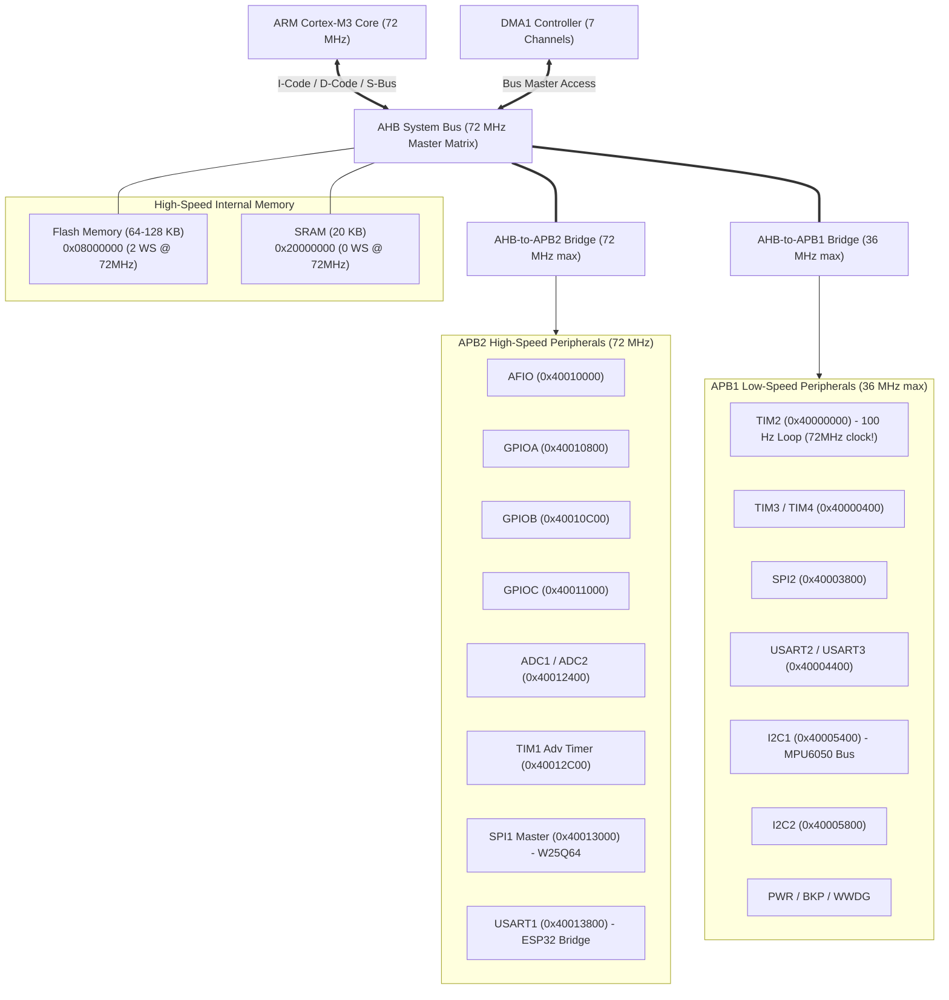
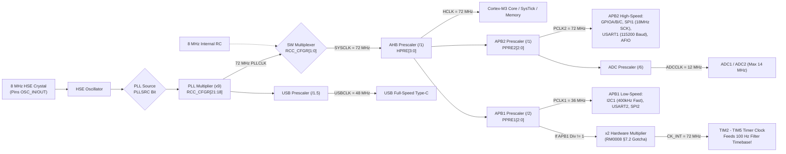
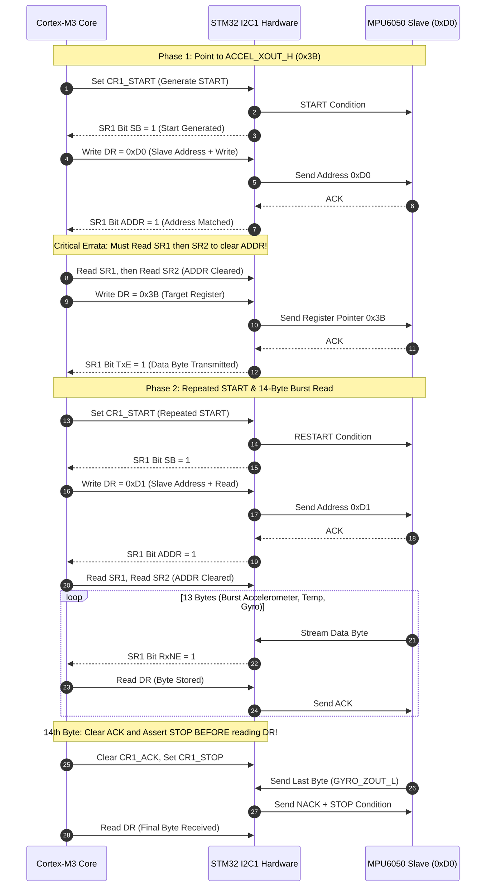
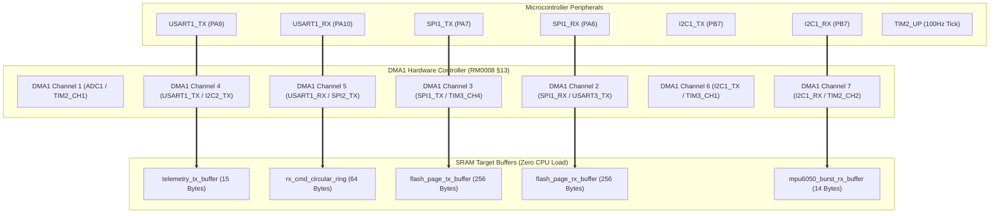

# STM32F103C8T6 (Blue Pill) Microcontroller Deep Dive & RM0008 Section 9 Reference

**Target Silicon:** STM32F103C8T6 Medium-Density Performance Line  
**Core:** ARM 32-bit Cortex-M3 (ARMv7-M Architecture, $72\text{ MHz}$ max)  
**Package:** LQFP48 ($7\times 7\text{ mm}$, $0.5\text{ mm}$ pitch)  
**Primary Datasheet:** STMicroelectronics *STM32F103x8 / STM32F103xB Datasheet* (DocID 13587 Rev 17)  
**Reference Manual:** STMicroelectronics *RM0008 Reference Manual: STM32F101xx, STM32F102xx, STM32F103xx, STM32F105xx and STM32F107xx advanced ARM-based 32-bit MCUs* (DocID 13902 Rev 16 / Rev 21) — **Section 9: General-purpose and alternate-function I/Os (GPIOs and AFIOs)** (pp. 158–195).

---

## 1. Physical Pin Layout & Hardware Boot Configuration

### 1.1 Blue Pill LQFP48 Physical Pinout

```text
                                [ USB Port (Type-C) ]
                                 +-----------------+
                           VBAT -| [1]        [40] |- GND
                            PC13 -| [2]        [39] |- GND
                            PC14 -| [3]        [38] |- 3.3V
                            PC15 -| [4]        [37] |- RESET (NRST)
                            PA0  -| [5]        [36] |- PB11 (I2C2_SDA / USART3_RX)
                            PA1  -| [6]        [35] |- PB10 (I2C2_SCL / USART3_TX)
                            PA2  -| [7]        [34] |- PB1  (TIM3_CH4 / ADC12_IN9)
                            PA3  -| [8]        [33] |- PB0  (TIM3_CH3 / ADC12_IN8)
 (SPI1_NSS)   PA4  -| [9]        [32] |- PA7  (SPI1_MOSI / TIM3_CH2)
 (SPI1_SCK)   PA5  -| [10]       [31] |- PA6  (SPI1_MISO / TIM3_CH1)
 (SPI1_MISO)  PA6  -| [11]       [30] |- PA5  (SPI1_SCK / ADC12_IN5)
 (SPI1_MOSI)  PA7  -| [12]       [29] |- PA4  (SPI1_NSS / ADC12_IN4)
                            PB0  -| [13]       [28] |- PA3  (USART2_RX / TIM2_CH4)
                            PB1  -| [14]       [27] |- PA2  (USART2_TX / TIM2_CH3)
                            PB10 -| [15]       [26] |- PA1  (TIM2_CH2 / ADC12_IN1)
                            PB11 -| [16]       [25] |- PA0  (TIM2_CH1_ETR / WAKEUP)
                            RESET-| [17]       [24] |- PC15 (OSC32_OUT)
                            3.3V -| [18]       [23] |- PC14 (OSC32_IN)
                            GND  -| [19]       [22] |- PC13 (TAMPER-RTC / User LED)
                            GND  -| [20]       [21] |- VBAT (Battery backup power)
                                 +-----------------+
                                  [ SWD Header: GND CLK DIO 3V3 ]
```

### 1.2 Dedicated Project Peripheral Pin Allocations

#### Dual-MCU Hardware Interconnect Topology:

```mermaid
graph TD
    subgraph STLINK["ST-LINK V2 SWD Programmer"]
        SWDIO["SWDIO (Pin 2)"]
        SWCLK["SWCLK (Pin 4)"]
        STGND["GND (Pin 6)"]
        ST3V3["3.3V (Pin 8)"]
    end

    subgraph STM32["STM32F103C8T6 (Master Inclinometer Engine)"]
        PA13["PA13 (SWDIO)"]
        PA14["PA14 (SWCLK)"]
        PC13["PC13 (Status LED)"]
        PA9["PA9 (USART1_TX)"]
        PA10["PA10 (USART1_RX)"]
        PA4["PA4 (Flash CS)"]
        PA5["PA5 (SPI1_SCK)"]
        PA6["PA6 (SPI1_MISO)"]
        PA7["PA7 (SPI1_MOSI)"]
        PB6["PB6 (I2C1_SCL)"]
        PB7["PB7 (I2C1_SDA)"]
        PB5["PB5 (EXTI5_INT)"]
    end

    subgraph MPU["GY-521 MPU6050 (6-DoF IMU)"]
        MPU_SCL["SCL"]
        MPU_SDA["SDA"]
        MPU_INT["INT (Data Ready)"]
    end

    subgraph FLASH["Winbond W25Q64 (64Mbit SPI Flash)"]
        FL_CS["/CS"]
        FL_CLK["CLK"]
        FL_DO["DO (MISO)"]
        FL_DI["DI (MOSI)"]
    end

    subgraph ESP["ESP32-WROOM-32 (Display & Dashboard Engine)"]
        ESP_RX2["GPIO16 (U2_RXD)"]
        ESP_TX2["GPIO17 (U2_TXD)"]
        ESP_SCK["GPIO18 (VSPI_SCK)"]
        ESP_MOSI["GPIO23 (VSPI_MOSI)"]
        ESP_MISO["GPIO19 (VSPI_MISO)"]
        ESP_CS["GPIO15 (TFT_CS)"]
        ESP_DC["GPIO2 (TFT_DC)"]
        ESP_RST["GPIO4 (TFT_RST)"]
        ESP_LED["GPIO32/5 (TFT_LED)"]
    end

    subgraph TFT["ILI9341 2.8in SPI TFT (320x240)"]
        TFT_SCK_PIN["SCK"]
        TFT_MOSI_PIN["SDI (MOSI)"]
        TFT_MISO_PIN["SDO (MISO)"]
        TFT_CS_PIN["CS"]
        TFT_DC_PIN["D/C"]
        TFT_RST_PIN["RESET"]
        TFT_LED_PIN["LED / BLK"]
    end

    %% Wiring Links
    SWDIO <== "SWD Data" ==> PA13
    SWCLK -->|SWD Clock| PA14
    PB6 <== "I2C 400kHz (4.7k Pull-up)" ==> MPU_SCL
    PB7 <== "I2C 400kHz (4.7k Pull-up)" ==> MPU_SDA
    MPU_INT -->|EXTI5 Trigger| PB5
    PA4 -->|CS Active LOW| FL_CS
    PA5 -->|SCK 18 MHz| FL_CLK
    PA7 -->|MOSI| FL_DI
    FL_DO -->|MISO| PA6
    PA9 -->|115200 Baud Telemetry| ESP_RX2
    ESP_TX2 -->|Commands / ACKs| PA10
    ESP_SCK --> TFT_SCK_PIN
    ESP_MOSI --> TFT_MOSI_PIN
    TFT_MISO_PIN --> ESP_MISO
    ESP_CS --> TFT_CS_PIN
    ESP_DC --> TFT_DC_PIN
    ESP_RST --> TFT_RST_PIN
    ESP_LED --> TFT_LED_PIN
```



| Pin | Peripheral Function | Hardware Wiring Target | Mode & Electrical Configuration (RM0008 §9.1.11) |
|---|---|---|---|
| **`PC13`** | GPIO Output | Onboard Active-LOW Green LED | General Purpose Output Push-Pull, $2\text{ MHz}$ slew rate (`MODE=10, CNF=00`). Sinks $\approx 2\text{ mA}$. |
| **`PB6`** | `I2C1_SCL` | GY-521 MPU6050 Clock | Alternate Function Open-Drain (`MODE=11, CNF=11`). Requires external $4.7\text{k}\Omega$ pull-up to 3.3V. |
| **`PB7`** | `I2C1_SDA` | GY-521 MPU6050 Data | Alternate Function Open-Drain (`MODE=11, CNF=11`). Requires external $4.7\text{k}\Omega$ pull-up to 3.3V. |
| **`PB5`** | `EXTI5` | GY-521 MPU6050 `INT` | Input with Internal Pull-Up (`MODE=00, CNF=10, ODR=1`). Mapped to EXTI5 via `AFIO_EXTICR2`. |
| **`PA4`** | GPIO Output (`CS`) | W25Q64 Flash `/CS` | General Purpose Output Push-Pull, $50\text{ MHz}$ slew rate (`MODE=11, CNF=00`). Manual software assertion. |
| **`PA5`** | `SPI1_SCK` | W25Q64 Flash `CLK` | Alternate Function Push-Pull, $50\text{ MHz}$ (`MODE=11, CNF=10`). Clocked at $18\text{ MHz}$ (PCLK2/4). |
| **`PA6`** | `SPI1_MISO` | W25Q64 Flash `DO` | Input Floating / Input Pull-Up (`MODE=00, CNF=01` or `CNF=10`). Driven by external SPI slave. |
| **`PA7`** | `SPI1_MOSI` | W25Q64 Flash `DI` | Alternate Function Push-Pull, $50\text{ MHz}$ (`MODE=11, CNF=10`). Master output data stream. |
| **`PA9`** | `USART1_TX` | ESP32 `GPIO16` (RX2) | Alternate Function Push-Pull, $50\text{ MHz}$ (`MODE=11, CNF=10`). Transmits $115200\text{ baud}$ telemetry. |
| **`PA10`**| `USART1_RX` | ESP32 `GPIO17` (TX2) | Input Floating / Input Pull-Up (`MODE=00, CNF=01` or `CNF=10, ODR=1`). Receives ACK/commands. |
| **`PA13`**| `SYS_JTMS-SWDIO` | ST-LINK V2 SWD Data | Bi-directional SWD debug line. Internal weak pull-up active at reset (RM0008 §9.1.1). |
| **`PA14`**| `SYS_JTCK-SWCLK` | ST-LINK V2 SWD Clock| Dedicated SWD clock input. Internal weak pull-down active at reset (RM0008 §9.1.1). |

### 1.3 Hardware Boot Logic (`BOOT0` and `BOOT1`) (RM0008 §3.4, Table 9)

At the rising edge of `NRST` (pin 17), the Cortex-M3 hardware latches the logic state of pins `BOOT0` and `BOOT1` (`PB2` on LQFP48). This dictates what physical memory block is mapped (aliased) to address `0x00000000`:

| `BOOT0` Jumper | `BOOT1` Jumper | Selected Boot Mode | Aliased Memory Base | Operating Context & Mechanism |
|:---:|:---:|---|---|---|
| **`0` (GND)** | **`X` (Don't care)** | **Main Flash Memory** | **`0x08000000`** | **Normal Operation:** CPU fetches initial MSP from `0x08000000` and Reset Handler address from `0x08000004`. |
| **`1` (3.3V)** | **`0` (GND)** | **System Memory** | `0x1FFFF000` | **Factory ROM Bootloader:** ST embedded factory bootloader for ISP flashing over `USART1` (PA9/PA10). |
| **`1` (3.3V)** | **`1` (3.3V)** | **Embedded SRAM** | `0x20000000` | **RAM Execution:** Debugging test routines without flashing flash memory, eliminating silicon flash endurance wear. |

---

## 2. Datasheet Specifications & Silicon Memory Architecture

| Silicon Parameter | Official Specification | System Implementation Details |
|---|---|---|
| **CPU Architecture** | ARM Cortex-M3 (ARMv7-M) | 3-stage Harvard pipeline, branch speculation, single-cycle $32\times 32$ MAC, hardware divide ($2\text{–}12\text{ cycles}$). |
| **Core Frequency ($f_{\text{HCLK}}$)**| $72\text{ MHz}$ max | Derived from external $8.000\text{ MHz}$ HSE crystal $\times 9$ PLL multiplier ($1.25\text{ DMIPS/MHz} = 90\text{ DMIPS}$). |
| **Flash Memory** | $64\text{ KB}$ nominal ($128\text{ KB}$ physical) | Sector size: $1\text{ KB}$ pages ($0x08000000 - 0x0801FFFF$). $2\text{ wait states}$ required for $f_{\text{HCLK}} > 48\text{ MHz}$ (RM0008 §3.3.3). |
| **SRAM** | $20\text{ KB}$ ($20480\text{ bytes}$) | Address range: $0x20000000 - 0x20004FFF$. Zero wait-state access at $72\text{ MHz}$. |
| **Operating Voltage ($V_{\text{DD}}$)**| $2.0\text{V} - 3.6\text{V}$ (Nominal $3.3\text{V}$) | Regulated on Blue Pill via onboard Torex/Micrel RT9193-33 LDO fed from 5V USB Type-C. |
| **I/O Tolerances** | Standard vs 5V-Tolerant (FT) | Non-FT pins: max $V_{\text{DD}} + 0.3\text{V}$. FT pins: max $5.5\text{V}$ (revoked in analog mode!). |

---

## 3. Peripheral Bus Matrix & Memory Map (RM0008 §3.3)

All microcontroller peripherals are mapped into the $0x40000000 - 0x5FFFFFFF$ space partitioned across three independent internal buses:



```text
                               +----------------------------+
                               | ARM Cortex-M3 Core (72MHz) |
                               +----------------------------+
                                             |
                                   [ AHB System Bus (72 MHz) ]
                                   |         |          |
         +-------------------------+         |          +-------------------------+
         |                                   |                                    |
[ DMA1 / CRC / Flash IF ]        [ APB2 High-Speed (72MHz) ]             [ APB1 Low-Speed (36MHz Max) ]
                                 - AFIO    (0x40010000)                  - TIM2, TIM3, TIM4
                                 - GPIOA   (0x40010800)                  - I2C1   (0x40005400)
                                 - GPIOB   (0x40010C00)                  - I2C2   (0x40005800)
                                 - GPIOC   (0x40011000)                  - USART2 (0x40004400)
                                 - ADC1/2  (0x40012400)                  - USART3 (0x40004800)
                                 - TIM1    (0x40012C00)                  - SPI2   (0x40003800)
                                 - SPI1    (0x40013000)                  - WWDG / PWR / BKP
                                 - USART1  (0x40013800)
```

---

## 4. Deep Dive: RM0008 Section 9 — GPIO and AFIO Subsystem

STMicroelectronics Reference Manual **RM0008 Section 9** (pages 158 through 195) specifies the entire electrical and register architecture for the General-Purpose and Alternate-Function I/O blocks.

### 4.1 Internal Silicon Hardware Architecture (RM0008 §9.1, Figures 13 & 14)

Each GPIO pin on the STM32F103 consists of a configurable bidirectional CMOS driver structure coupled to an input Schmitt trigger, internal pull resistors, and alternate-function routing logic.

```text
                  +----------------- VDD (or VDD_FT) -----------------+
                  |                                                   |
                  |                +---+ (Pull-Up Resistor ~40k)       |
                  |                | R |                              |
                  |                +---+                              |
                  |                  |       P-MOS                    |
                  |                  +-------[ / ]----+               |
                  |                  |     (Output)   |               |
[ Output Data ] --+--> Output Driver-+                +------> PIN ---+
[ Register ODR]        (Push-Pull/   |     N-MOS      |      (External)
[ / Peripheral]         Open-Drain)  +-------[ / ]----+               |
                                     |     (Output)   |               |
                                    ===              ===              |
                                    GND              GND              |
                                     |                                |
                                     +---+ (Pull-Down Resistor ~40k)  |
                                     | R |                            |
                                     +---+                            |
                                     |                                |
                                    ===                               |
                                    GND                               |
                                                                      |
[ Input Data  ] <-----------------+--- Schmitt Trigger <--------------+
[ Register IDR]                   |     (TTL Thresholds)              |
[ / Peripheral]                   |                                   |
                                  +---> Analog Input Multiplexer -----+
                                       (Bypasses Schmitt Trigger)
```

#### Key Silicon Insights:
1. **Standard I/O vs 5V-Tolerant ($V_{\text{DD\_FT}}$) Pins (RM0008 §9.1, pp. 158–159):**
   - **Standard I/O Pin (Figure 13):** Clamped to both $V_{\text{SS}}$ and $V_{\text{DD}}$ via standard silicon diodes. Applying any voltage exceeding $V_{\text{DD}} + 0.3\text{V}$ will forward-bias the upper protection diode, dumping parasitic current into the $3.3\text{V}$ rail.
   - **Five-Volt Tolerant ($V_{\text{DD\_FT}}$) Pin (Figure 14):** Features an upper protection clamp tied to a dedicated internal silicon potential ($V_{\text{DD\_FT}}$). This prevents forward-conduction when driven up to $5.5\text{V}$ while $V_{\text{DD}} = 3.3\text{V}$.
   - **CRITICAL HARDWARE GOTCHA (RM0008 §9.1.10, p. 165):** When an FT pin is configured in **Analog Input mode** (`CNF=00, MODE=00`), the $5\text{V}$ tolerance is **physically disabled**. Driving $> V_{\text{DD}} + 0.3\text{V}$ ($3.6\text{V}$) into an analog-configured pin will cause permanent oxide punch-through damage to the ADC analog switch!
2. **Push-Pull vs Open-Drain Output Dynamics (RM0008 §9.1.8, p. 163):**
   - **Push-Pull (`CNF[0] = 0`):** Both P-MOS and N-MOS transistors are actively driven. When output is `1`, P-MOS strongly ties pin to $V_{\text{DD}}$. When output is `0`, N-MOS strongly ties pin to $V_{\text{SS}}$. Provides symmetrical rise/fall times for high-speed buses (SPI, UART TX, LED).
   - **Open-Drain (`CNF[0] = 1`):** P-MOS is permanently deactivated. Writing `0` turns on N-MOS ($V_{\text{SS}}$ sink). Writing `1` leaves the pin high-impedance (High-Z). An external pull-up resistor is mandatory to pull the line to $V_{\text{DD}}$ (required for wired-AND buses like $I^2C$ `SCL`/`SDA`).
3. **Schmitt Trigger Action:** Input signals pass through an internal hysteresis buffer (TTL-compatible thresholds: $V_{\text{IL}} \approx 0.35 V_{\text{DD}}$, $V_{\text{IH}} \approx 0.65 V_{\text{DD}}$). The input data register (`GPIOx_IDR`) latches the pin state on every APB2 peripheral clock edge. In Analog mode, this Schmitt trigger is deactivated to eliminate dynamic cross-conduction current.

---

### 4.2 Port Configuration Registers: `GPIOx_CRL` & `GPIOx_CRH` (RM0008 §9.2.1–9.2.2, pp. 170–171)

Each 16-pin GPIO port is configured using two 32-bit registers where every individual pin consumes exactly 4 control bits:
- **`GPIOx_CRL` (Offset `0x00`):** Controls low pins **0 through 7**.
- **`GPIOx_CRH` (Offset `0x04`):** Controls high pins **8 through 15**.

#### Bitfield Bit-Position Mathematical Formula:
For any pin index $n \in [0, 15]$:
$$\text{Target Register} = \begin{cases} \text{GPIOx\_CRL}, & 0 \le n \le 7 \\ \text{GPIOx\_CRH}, & 8 \le n \le 15 \end{cases}$$
$$\text{Bit Shift Offset} = (n \pmod 8) \times 4$$
$$\text{MODE}[1:0] \implies \text{Bits } [\text{Shift}+1 : \text{Shift}], \quad \text{CNF}[1:0] \implies \text{Bits } [\text{Shift}+3 : \text{Shift}+2]$$

#### Master Configuration Matrix (RM0008 §9.1.1, Table 20 & Table 21, p. 160)

| Mode Class | Desired Functional Pin Mode | `CNF1` | `CNF0` | `MODE1` | `MODE0` | 4-bit Nibble (Hex) | Mandatory `ODR` State | Typical Application |
|---|---|:---:|:---:|:---:|:---:|:---:|:---:|---|
| **Input** | **Analog Mode** | `0` | `0` | `0` | `0` | `0x0` | Don't care | ADC Channel Inputs, low-power sleep pins. |
| **Input** | **Input Floating (Reset State)** | `0` | `1` | `0` | `0` | `0x4` | Don't care | High-Z inputs, buttons with external pull resistors, SPI MISO. |
| **Input** | **Input with Pull-Down** | `1` | `0` | `0` | `0` | `0x8` | **`ODR = 0`** | Active-HIGH button inputs, fail-safe digital inputs. |
| **Input** | **Input with Pull-Up** | `1` | `0` | `0` | `0` | `0x8` | **`ODR = 1`** | Active-LOW button inputs, EXTI sensor interrupt lines (PB5). |
| **Output** | **General Purpose Push-Pull $10\text{ MHz}$** | `0` | `0` | `0` | `1` | `0x1` | Data out (`0`/`1`) | General digital signaling. |
| **Output** | **General Purpose Push-Pull $2\text{ MHz}$** | `0` | `0` | `1` | `0` | `0x2` | Data out (`0`/`1`) | Low-EMI control, Onboard LED (`PC13`). |
| **Output** | **General Purpose Push-Pull $50\text{ MHz}$** | `0` | `0` | `1` | `1` | `0x3` | Data out (`0`/`1`) | High-speed GPIO, Manual SPI Chip Select (`PA4`). |
| **Output** | **General Purpose Open-Drain $50\text{ MHz}$** | `0` | `1` | `1` | `1` | `0x7` | Data out (`0`/`1`) | Bit-banged open-drain buses, level-shifter outputs. |
| **Alternate** | **Alternate Function Push-Pull $50\text{ MHz}$** | `1` | `0` | `1` | `1` | `0xB` | Controlled by Periph | Hardware Master `SPI1_SCK` (`PA5`), `SPI1_MOSI` (`PA7`), `USART1_TX` (`PA9`). |
| **Alternate** | **Alternate Function Open-Drain $50\text{ MHz}$**| `1` | `1` | `1` | `1` | `0xF` | Controlled by Periph | Hardware Master `I2C1_SCL` (`PB6`), `I2C1_SDA` (`PB7`). |

> **Reset Value:** Both `GPIOx_CRL` and `GPIOx_CRH` reset to `0x44444444` (RM0008 §9.5, Table 59), meaning every pin defaults to **Input Floating** (`CNF=01, MODE=00`).

---

### 4.3 Atomic Bit Set / Reset Architecture: `BSRR` vs `BRR` (RM0008 §9.1.2 & §9.2.5–9.2.6, pp. 160, 172–173)

#### The Concurrency Race Condition Hazard:
Modifying individual bits via `GPIOx_ODR` requires a read-modify-write cycle:
```c
// DANGEROUS: Non-atomic Read-Modify-Write
GPIOA->ODR |= (1 << 4);  // Compiled to: LDR r0, [r1]; ORR r0, #16; STR r0, [r1]
```
If an Interrupt Service Routine (ISR) preempts the CPU between the `LDR` and `STR` instructions and writes to another pin on `GPIOA`, the main thread's subsequent `STR` will **silently overwrite and revert** the ISR's modifications!

#### Hardware Solution: Single-Cycle Atomic Register Write
- **`GPIOx_BSRR` (Address Offset `0x10`, Reset `0x00000000`):**
  - **Bits `15:0` (`BS0` to `BS15`):** Write `1` to set pin $y$ to logic HIGH. Write `0` = No operation.
  - **Bits `31:16` (`BR0` to `BR15`):** Write `1` to clear pin $y$ to logic LOW. Write `0` = No operation.
- **Priority Invariant (RM0008 §9.2.5, p. 172):**
  $$\text{If both } BS_y \text{ and } BR_y \text{ are set to } 1 \text{ in the same 32-bit word, } \mathbf{BS_y} \text{ has absolute hardware priority!}$$
  The pin will be driven HIGH.
- **`GPIOx_BRR` (Address Offset `0x14`, Reset `0x00000000`):**
  - Contains only 16 bits (`BR0` to `BR15`). Writing `1` clears the pin. Exists primarily for compatibility with older 16-bit bus controllers.

```c
// SAFE & ATOMIC: Zero Read-Modify-Write, Zero Interrupt Disabling
GPIOA->BSRR = (1 << 4);        // Atomically set PA4 HIGH (CS Deassert)
GPIOA->BSRR = (1 << (4 + 16)); // Atomically clear PA4 LOW (CS Assert)
// Alternatively using BRR:
GPIOA->BRR  = (1 << 4);        // Atomically clear PA4 LOW
```

---

### 4.4 Port Configuration Lock Mechanism: `GPIOx_LCKR` (RM0008 §9.1.6 & §9.2.7, pp. 161, 173–174)

The lock register freezes the pin configuration bits (`CRL` and `CRH`) for designated pins. Once a pin is locked, software **cannot modify its direction, mode, or speed** until the next microcontroller hardware reset. This is essential for safety-critical pins (e.g., motor emergency stops, oscillator pins).

#### Register Structure (`GPIOx_LCKR`, Offset `0x18`):
- **Bits `15:0` (`LCK[15:0]`):** Bitmask of pins to lock.
- **Bit `16` (`LCKK`):** Lock Key control bit.

#### Strict Silicon Unlock Sequence (RM0008 §9.2.7, p. 173):
To lock the configuration of selected pins, software must execute the exact 5-step write/read sequence without interruption:

$$\text{Step 1: } \text{LCKR} \leftarrow (1 \ll 16) \mid \text{PinMask} \quad (\text{LCKK}=1)$$
$$\text{Step 2: } \text{LCKR} \leftarrow \text{PinMask} \quad (\text{LCKK}=0)$$
$$\text{Step 3: } \text{LCKR} \leftarrow (1 \ll 16) \mid \text{PinMask} \quad (\text{LCKK}=1)$$
$$\text{Step 4: } \text{Read } \text{LCKR} \quad (\text{Hardware returns } \text{LCKK}=0)$$
$$\text{Step 5: } \text{Read } \text{LCKR} \quad (\text{Hardware returns } \text{LCKK}=1 \implies \text{LOCK ACTIVE})$$

```c
// Production Implementation of RM0008 §9.2.7 Lock Routine
void GPIO_LockPinConfiguration(GPIO_TypeDef *GPIOx, uint16_t pin_mask) {
    uint32_t tmp = (1 << 16) | pin_mask;
    GPIOx->LCKR = tmp;        // Step 1: LCKK=1
    GPIOx->LCKR = pin_mask;   // Step 2: LCKK=0
    GPIOx->LCKR = tmp;        // Step 3: LCKK=1
    tmp = GPIOx->LCKR;        // Step 4: First Read (returns 0)
    tmp = GPIOx->LCKR;        // Step 5: Second Read (returns 1 on bit 16)
    (void)tmp;                // Prevent unused variable compiler warning
}
```

---

### 4.5 Alternate Function I/O & Remapping Controller (AFIO) (RM0008 §9.3 & §9.4, pp. 174–193)

The AFIO peripheral multiplexes on-chip peripheral signals to physical package pins and routes external interrupts to the EXTI controller.

#### 1. Mandatory Clock Enabling Gate:
> **RULE:** Before reading or writing ANY AFIO register (`AFIO_EVCR`, `AFIO_MAPR`, `AFIO_EXTICR1..4`), the AFIO peripheral clock **MUST** be enabled in `RCC->APB2ENR`:
> ```c
> RCC->APB2ENR |= RCC_APB2ENR_AFIOEN; // Enable AFIO clock on APB2 (Bit 0)
> ```
> If `AFIOEN` is zero, all writes to AFIO registers are **silently ignored** by the bus fabric!

#### 2. JTAG / SWD Debug Port Remapping (`AFIO_MAPR[26:24]` `SWJ_CFG`) (RM0008 §9.3.5 & Table 37, p. 175):
At reset, pins `PA13`, `PA14`, `PA15`, `PB3`, and `PB4` are dedicated to 5-wire JTAG debug. In space-constrained applications like Blue Pill boards, software reconfigures bits `26:24` to release unused JTAG pins for GPIO:

| `SWJ_CFG[2:0]` | Binary Value | JTAG Status | SWD Status | Released Pins Usable as General GPIO | Risk / Precaution |
|:---:|:---:|:---:|:---:|---|---|
| **Full SWJ** (Default) | `0b000` (`0x0`) | **Enabled** | **Enabled** | None (All 5 pins reserved for debug). | Reset default. |
| **SWJ without NJTRST** | `0b001` (`0x1`) | **Enabled** | **Enabled** | **`PB4`** freed as GPIO. | Safe. JTAG still operational. |
| **SW-DP Enabled (Recommended)** | `0b010` (`0x2`) | **Disabled** | **Enabled** | **`PA15`**, **`PB3`**, **`PB4`** freed as GPIO! | **Optimal for Blue Pill:** Frees 3 pins while retaining ST-LINK SWD on PA13/PA14. |
| **No Debug (Full Disable)** | `0b100` (`0x4`) | **Disabled** | **Disabled** | **`PA13`**, **`PA14`**, **`PA15`**, **`PB3`**, **`PB4`** all freed! | **DANGER:** MCU will refuse ST-LINK connection unless hardware reset or BOOT0 pull-up is applied! |

#### 3. Peripheral Alternate Function Remapping Matrix (`AFIO_MAPR`) (RM0008 §9.4.2, pp. 183–189):

| Peripheral Remap Field | Bit Position | Value | Default Pin Allocation (`0`) | Remapped Pin Allocation (`1`) | Hardware Constraint |
|---|:---:|:---:|---|---|---|
| **`SPI1_REMAP`** | Bit 0 | `0` / `1` | NSS/`PA4`, SCK/`PA5`, MISO/`PA6`, MOSI/`PA7` | NSS/`PA15`, SCK/`PB3`, MISO/`PB4`, MOSI/`PB5` | **Requires JTAG Disable (`SWJ_CFG=010`)** because PB3, PB4, and PA15 overlap with JTAG! |
| **`I2C1_REMAP`** | Bit 1 | `0` / `1` | SCL/`PB6`, SDA/`PB7` | SCL/`PB8`, SDA/`PB9` | Useful when PB6/PB7 conflict with USART1 remap or TIM4. |
| **`USART1_REMAP`** | Bit 2 | `0` / `1` | TX/`PA9`, RX/`PA10` | TX/`PB6`, RX/`PB7` | Conflicts with default I2C1 pins! |
| **`USART2_REMAP`** | Bit 3 | `0` / `1` | CTS/`PA0`, RTS/`PA1`, TX/`PA2`, RX/`PA3`, CK/`PA4` | CTS/`PD3`, RTS/`PD4`, TX/`PD5`, RX/`PD6`, CK/`PD7` | Requires high-density package with Port D pins. |
| **`USART3_REMAP[1:0]`** | Bits 5:4 | `00` / `01` / `11` | `PB10`, `PB11`, `PB12`, `PB13`, `PB14` | Partial: `PC10`, `PC11`, `PC12` / Full: Port D | Partial remap usable on 64-pin and 100-pin packages. |
| **`TIM1_REMAP[1:0]`** | Bits 7:6 | `00` / `01` / `11` | `PA8`, `PA9`, `PA10`, `PA11`, `PA12` | Partial: `PA8..11`, `PB12..15` / Full: `PE7..15` | Remapping for motor drive complementary PWM. |
| **`TIM2_REMAP[1:0]`** | Bits 9:8 | `00` / `01` / `10` / `11` | `PA0`, `PA1`, `PA2`, `PA3` | Partial 1: `PA15`, `PB3`, `PA2`, `PA3` / Partial 2: `PA0`, `PA1`, `PB10`, `PB11` / Full: `PB3`, `PB10`, `PB11` | Allows flexible timer capture on remapped GPIOs. |
| **`TIM3_REMAP[1:0]`** | Bits 11:10 | `00` / `10` / `11` | `PA6`, `PA7`, `PB0`, `PB1` | Partial: `PB4`, `PB5`, `PB0`, `PB1` / Full: `PC6..PC9` | Partial remap uses PB4/PB5. |

#### 4. External Interrupt Line Routing (`AFIO_EXTICR1` to `AFIO_EXTICR4`) (RM0008 §9.4.3–9.4.6, pp. 190–191):
The STM32 features 16 external interrupt lines (`EXTI0` to `EXTI15`). However, multiple physical pins share each line index (e.g., `PA0`, `PB0`, `PC0` all route to `EXTI0`). The `AFIO_EXTICRx` registers select which GPIO port connects to each line:

$$\text{Target Register} = \text{AFIO\_EXTICR}[ line / 4 ] \quad (\text{EXTICR1 for lines 0..3, EXTICR2 for lines 4..7, etc.})$$
$$\text{Nibble Shift} = (line \pmod 4) \times 4$$
$$\text{Port Multiplexer Codes: } \mathbf{0x0} = \text{Port A}, \quad \mathbf{0x1} = \text{Port B}, \quad \mathbf{0x2} = \text{Port C}, \quad \mathbf{0x3} = \text{Port D}$$

##### MPU6050 `PB5` to NVIC Signal Chain Architecture:

```mermaid
flowchart TD
    subgraph PINS["GPIO Source Pins for Line 5"]
        PA5["PA5"]
        PB5["PB5 (MPU6050 INT - Data Ready)"]
        PC5["PC5"]
        PD5["PD5"]
    end

    subgraph AFIO_EXTI["AFIO Multiplexer (RM0008 §9.4.4)"]
        MUX["AFIO_EXTICR2 (Bits 7:4)<br/>0x0: PA5 | 0x1: PB5 | 0x2: PC5 | 0x3: PD5"]
    end

    subgraph EXTI_BLOCK["EXTI Controller Line 5 (RM0008 §10.2)"]
        EDGE["Edge Trigger Detector<br/>EXTI_FTSR: Falling Edge<br/>EXTI_RTSR: Rising Edge"]
        PR["EXTI_PR (Pending Register Bit 5)<br/>*Write '1' to Clear Flag!*"]
        IMR{"EXTI_IMR (Bit 5)<br/>Interrupt Mask"}
    end

    subgraph NVIC_CORE["NVIC & Cortex-M3 Core"]
        NVIC["NVIC Interrupt Controller<br/>IRQ #23: EXTI9_5_IRQn<br/>Vector: 0x009C"]
        ISR["EXTI9_5_IRQHandler()<br/>1. Reads MPU6050 FIFO/Registers<br/>2. Writes EXTI->PR = (1 << 5)"]
    end

    PA5 -.-> MUX
    PB5 ===|AFIO_EXTICR2 = 0x1| MUX
    PC5 -.-> MUX
    PD5 -.-> MUX

    MUX -->|EXTI Line 5| EDGE
    EDGE -->|Active Edge Detected| PR
    PR --> IMR
    IMR -->|If Unmasked (IMR=1)| NVIC
    NVIC -->|Triggers Exception| ISR
```

```c
// Example: Route PB5 (MPU6050 INT pin) to EXTI line 5
RCC->APB2ENR |= RCC_APB2ENR_AFIOEN;              // 1. Enable AFIO clock
AFIO->EXTICR[1] &= ~(0xFu << 4);                 // 2. Clear EXTI5[3:0] nibble (bits 7:4)
AFIO->EXTICR[1] |=  (0x1u << 4);                 // 3. Set to 0x1 (Port B selected for EXTI5)
```

---

### 4.6 Complete Section 9 Register Memory Map (RM0008 §9.5, Table 59, pp. 193–195)

All GPIO and AFIO registers are mapped with 32-bit alignment. Byte or 16-bit half-word write access to configuration registers is prohibited.

| Base Address | Register Mnemonic | Address Offset | Full Physical Address | Hardware Reset Value | Register Function & Access Rules |
|---|---|:---:|---|:---:|---|
| **`GPIOA` (`0x40010800`)** | `GPIOA_CRL` | `+ 0x00` | `0x40010800` | `0x44444444` | Port A Configuration Register Low (Pins 0–7). RW. |
| | `GPIOA_CRH` | `+ 0x04` | `0x40010804` | `0x44444444` | Port A Configuration Register High (Pins 8–15). RW. |
| | `GPIOA_IDR` | `+ 0x08` | `0x40010808` | `0x0000XXXX` | Port A Input Data Register (Bits 15:0). Read-Only. |
| | `GPIOA_ODR` | `+ 0x0C` | `0x4001080C` | `0x00000000` | Port A Output Data Register (Bits 15:0). RW. |
| | `GPIOA_BSRR`| `+ 0x10` | `0x40010810` | `0x00000000` | Port A Bit Set/Reset Register (Bits 31:0). Write-Only. |
| | `GPIOA_BRR` | `+ 0x14` | `0x40010814` | `0x00000000` | Port A Bit Reset Register (Bits 15:0). Write-Only. |
| | `GPIOA_LCKR`| `+ 0x18` | `0x40010818` | `0x00000000` | Port A Configuration Lock Register. RW. |
| **`GPIOB` (`0x40010C00`)** | `GPIOB_CRL` | `+ 0x00` | `0x40010C00` | `0x44444444` | Port B Configuration Register Low (Pins 0–7). RW. |
| | `GPIOB_CRH` | `+ 0x04` | `0x40010C04` | `0x44444444` | Port B Configuration Register High (Pins 8–15). RW. |
| | `GPIOB_IDR` | `+ 0x08` | `0x40010C08` | `0x0000XXXX` | Port B Input Data Register. Read-Only. |
| | `GPIOB_ODR` | `+ 0x0C` | `0x40010C0C` | `0x00000000` | Port B Output Data Register. RW. |
| | `GPIOB_BSRR`| `+ 0x10` | `0x40010C10` | `0x00000000` | Port B Bit Set/Reset Register. Write-Only. |
| | `GPIOB_BRR` | `+ 0x14` | `0x40010C14` | `0x00000000` | Port B Bit Reset Register. Write-Only. |
| | `GPIOB_LCKR`| `+ 0x18` | `0x40010C18` | `0x00000000` | Port B Configuration Lock Register. RW. |
| **`GPIOC` (`0x40011000`)** | `GPIOC_CRH` | `+ 0x04` | `0x40011004` | `0x44444444` | Port C Configuration Register High (`PC13` at bits 23:20). RW. |
| | `GPIOC_ODR` | `+ 0x0C` | `0x4001100C` | `0x00000000` | Port C Output Data Register. RW. |
| | `GPIOC_BSRR`| `+ 0x10` | `0x40011010` | `0x00000000` | Port C Bit Set/Reset Register (`BS13` bit 13, `BR13` bit 29). |
| **`AFIO` (`0x40010000`)** | `AFIO_EVCR` | `+ 0x00` | `0x40010000` | `0x00000000` | Event Control Register (Cortex-M3 EVENTOUT output pin). |
| | `AFIO_MAPR` | `+ 0x04` | `0x40010004` | `0x00000000` | AF Remap and Debug I/O Configuration Register. |
| | `AFIO_EXTICR1`| `+ 0x08`| `0x40010008` | `0x00000000` | External Interrupt Configuration Register 1 (`EXTI0`..`EXTI3`). |
| | `AFIO_EXTICR2`| `+ 0x0C`| `0x4001000C` | `0x00000000` | External Interrupt Configuration Register 2 (`EXTI4`..`EXTI7`). |
| | `AFIO_EXTICR3`| `+ 0x10`| `0x40010010` | `0x00000000` | External Interrupt Configuration Register 3 (`EXTI8`..`EXTI11`). |
| | `AFIO_EXTICR4`| `+ 0x14`| `0x40010014` | `0x00000000` | External Interrupt Configuration Register 4 (`EXTI12`..`EXTI15`). |
| | `AFIO_MAPR2`| `+ 0x1C`| `0x4001001C` | `0x00000000` | AF Remap Register 2 (High-density timers: TIM9, TIM10, TIM11). |

---

## 5. Software Interaction Paradigms: Complete Runnable Code Snippets

### Paradigm 1: Bare-Metal Direct Memory-Mapped Register Manipulation
*Zero library overhead, deterministic compilation, smallest binary footprint ($120\text{ bytes}$).*

```c
#include <stdint.h>

// Direct Memory-Mapped Register Definitions
#define MMIO32(addr)            (*(volatile uint32_t *)(addr))

#define RCC_APB2ENR             MMIO32(0x40021018)
#define GPIOA_CRL               MMIO32(0x40010800)
#define GPIOA_CRH               MMIO32(0x40010804)
#define GPIOA_ODR               MMIO32(0x4001080C)
#define GPIOA_BSRR              MMIO32(0x40010810)
#define GPIOB_CRL               MMIO32(0x40010C00)
#define GPIOB_ODR               MMIO32(0x40010C0C)
#define GPIOC_CRH               MMIO32(0x40011004)
#define GPIOC_BSRR              MMIO32(0x40011010)
#define AFIO_MAPR               MMIO32(0x40010004)
#define AFIO_EXTICR2            MMIO32(0x4001000C)

void Hardware_Init_BareMetal(void) {
    // 1. Enable Clocks for AFIO, GPIOA, GPIOB, GPIOC on APB2 (RM0008 §7.3.7)
    // Bit 0: AFIOEN, Bit 2: IOPAEN, Bit 3: IOPBEN, Bit 4: IOPCEN
    RCC_APB2ENR |= (1 << 0) | (1 << 2) | (1 << 3) | (1 << 4);

    // 2. Configure PC13 as Output Push-Pull 2MHz (Onboard LED)
    // PC13 is at CRH bits 23:20. Nibble value: 0x2 (MODE=10, CNF=00)
    GPIOC_CRH &= ~(0xFu << 20);
    GPIOC_CRH |=  (0x2u << 20);
    GPIOC_BSRR = (1 << 13); // Turn off LED (Active LOW)

    // 3. Configure PA4 as Output Push-Pull 50MHz (Flash CS)
    // PA4 is at CRL bits 19:16. Nibble value: 0x3 (MODE=11, CNF=00)
    GPIOA_CRL &= ~(0xFu << 16);
    GPIOA_CRL |=  (0x3u << 16);
    GPIOA_BSRR = (1 << 4);  // Deassert CS (HIGH)

    // 4. Configure PA5 (SCK) and PA7 (MOSI) as AF Push-Pull 50MHz (SPI1)
    // Nibble value: 0xB (MODE=11, CNF=10). PA5 bits 23:20, PA7 bits 31:28
    GPIOA_CRL &= ~((0xFu << 20) | (0xFu << 28));
    GPIOA_CRL |=  ((0xBu << 20) | (0xBu << 28));

    // 5. Configure PA6 (MISO) as Input Floating (SPI1)
    // PA6 is at CRL bits 27:24. Nibble value: 0x4 (MODE=00, CNF=01)
    GPIOA_CRL &= ~(0xFu << 24);
    GPIOA_CRL |=  (0x4u << 24);

    // 6. Configure PA9 as AF Push-Pull 50MHz (USART1 TX)
    // PA9 is at CRH bits 7:4. Nibble value: 0xB (MODE=11, CNF=10)
    GPIOA_CRH &= ~(0xFu << 4);
    GPIOA_CRH |=  (0xBu << 4);

    // 7. Configure PA10 as Input with Pull-Up (USART1 RX)
    // PA10 is at CRH bits 11:8. Nibble: 0x8 (MODE=00, CNF=10) + ODR10 = 1
    GPIOA_CRH &= ~(0xFu << 8);
    GPIOA_CRH |=  (0x8u << 8);
    GPIOA_ODR |=  (1 << 10);

    // 8. Configure PB6 (SCL) and PB7 (SDA) as AF Open-Drain 50MHz (I2C1)
    // Nibble value: 0xF (MODE=11, CNF=11). PB6 bits 27:24, PB7 bits 31:28
    GPIOB_CRL &= ~((0xFu << 24) | (0xFu << 28));
    GPIOB_CRL |=  ((0xFu << 24) | (0xFu << 28));

    // 9. Configure PB5 as Input Pull-Up and route to EXTI5 (MPU6050 INT)
    // PB5 is at CRL bits 23:20. Nibble: 0x8 (MODE=00, CNF=10) + ODR5 = 1
    GPIOB_CRL &= ~(0xFu << 20);
    GPIOB_CRL |=  (0x8u << 20);
    GPIOB_ODR |=  (1 << 5);
    AFIO_EXTICR2 &= ~(0xFu << 4);
    AFIO_EXTICR2 |=  (0x1u << 4); // Port B selected for EXTI5

    // 10. Disable JTAG but keep SWD active (Release PB3, PB4, PA15)
    // SWJ_CFG bits 26:24 = 0b010 (RM0008 §9.3.5)
    AFIO_MAPR &= ~(0x7u << 24);
    AFIO_MAPR |=  (0x2u << 24);
}
```

---

### Paradigm 2: Standard CMSIS Register Definitions (`stm32f10x.h`)
*Industry standard, strongly typed, highly maintainable, full IDE symbol navigation.*

```c
#include "stm32f10x.h"

void Hardware_Init_CMSIS(void) {
    // 1. Enable APB2 Peripheral Clocks
    RCC->APB2ENR |= RCC_APB2ENR_AFIOEN |
                    RCC_APB2ENR_IOPAEN |
                    RCC_APB2ENR_IOPBEN |
                    RCC_APB2ENR_IOPCEN;

    // 2. Configure PC13 (LED) -> General Purpose Output Push-Pull 2MHz
    GPIOC->CRH &= ~(GPIO_CRH_MODE13 | GPIO_CRH_CNF13);
    GPIOC->CRH |= GPIO_CRH_MODE13_1; // MODE = 10 (2MHz), CNF = 00 (Push-Pull)
    GPIOC->BSRR = GPIO_BSRR_BS13;    // Active LOW: Write 1 to BS13 to turn OFF

    // 3. Configure PA4 (Flash CS) -> Push-Pull Output 50MHz
    GPIOA->CRL &= ~(GPIO_CRL_MODE4 | GPIO_CRL_CNF4);
    GPIOA->CRL |= (GPIO_CRL_MODE4_0 | GPIO_CRL_MODE4_1); // MODE = 11 (50MHz), CNF = 00
    GPIOA->BSRR = GPIO_BSRR_BS4;                         // CS = HIGH

    // 4. Configure SPI1 Pins: PA5 (SCK), PA7 (MOSI) -> AF Push-Pull 50MHz
    GPIOA->CRL &= ~((GPIO_CRL_MODE5 | GPIO_CRL_CNF5) | (GPIO_CRL_MODE7 | GPIO_CRL_CNF7));
    GPIOA->CRL |= (GPIO_CRL_MODE5 | GPIO_CRL_CNF5_1) | (GPIO_CRL_MODE7 | GPIO_CRL_CNF7_1);

    // PA6 (MISO) -> Input Floating
    GPIOA->CRL &= ~(GPIO_CRL_MODE6 | GPIO_CRL_CNF6);
    GPIOA->CRL |= GPIO_CRL_CNF6_0; // MODE = 00, CNF = 01

    // 5. Configure USART1: PA9 (TX) -> AF Push-Pull, PA10 (RX) -> Input Pull-Up
    GPIOA->CRH &= ~((GPIO_CRH_MODE9 | GPIO_CRH_CNF9) | (GPIO_CRH_MODE10 | GPIO_CRH_CNF10));
    GPIOA->CRH |= (GPIO_CRH_MODE9 | GPIO_CRH_CNF9_1);   // PA9: AF PP 50MHz
    GPIOA->CRH |= GPIO_CRH_CNF10_1;                     // PA10: Input with PU/PD
    GPIOA->BSRR = GPIO_BSRR_BS10;                       // Set ODR10 = 1 for Pull-Up

    // 6. Configure I2C1: PB6 (SCL), PB7 (SDA) -> AF Open-Drain 50MHz
    GPIOB->CRL &= ~((GPIO_CRL_MODE6 | GPIO_CRL_CNF6) | (GPIO_CRL_MODE7 | GPIO_CRL_CNF7));
    GPIOB->CRL |= (GPIO_CRL_MODE6 | GPIO_CRL_CNF6) | (GPIO_CRL_MODE7 | GPIO_CRL_CNF7);

    // 7. Configure PB5 (MPU6050 INT) -> Input Pull-Up + EXTI5 Remap
    GPIOB->CRL &= ~(GPIO_CRL_MODE5 | GPIO_CRL_CNF5);
    GPIOB->CRL |= GPIO_CRL_CNF5_1;
    GPIOB->BSRR = GPIO_BSRR_BS5; // Enable Pull-Up via ODR

    AFIO->EXTICR[1] &= ~AFIO_EXTICR2_EXTI5;
    AFIO->EXTICR[1] |= AFIO_EXTICR2_EXTI5_PB; // Route PB5 to EXTI5 line

    // 8. Reclaim JTAG pins (PB3, PB4, PA15) while keeping SWD active
    AFIO->MAPR = (AFIO->MAPR & ~AFIO_MAPR_SWJ_CFG) | AFIO_MAPR_SWJ_CFG_JTAGDISABLE;
}
```

---

### Paradigm 3: Standard Peripheral Library (SPL)
*Academic university curriculum standard (Keil µVision compatible).*

```c
#include "stm32f10x.h"
#include "stm32f10x_gpio.h"
#include "stm32f10x_rcc.h"

void Hardware_Init_SPL(void) {
    GPIO_InitTypeDef GPIO_InitStructure;

    // 1. Enable APB2 Clocks
    RCC_APB2PeriphClockCmd(RCC_APB2Periph_GPIOA |
                           RCC_APB2Periph_GPIOB |
                           RCC_APB2Periph_GPIOC |
                           RCC_APB2Periph_AFIO, ENABLE);

    // 2. Disable JTAG, Enable SWD (Frees PB3, PB4, PA15)
    GPIO_PinRemapConfig(GPIO_Remap_SWJ_JTAGDisable, ENABLE);

    // 3. Configure PC13 LED (Output Push-Pull 2MHz)
    GPIO_InitStructure.GPIO_Pin = GPIO_Pin_13;
    GPIO_InitStructure.GPIO_Mode = GPIO_Mode_Out_PP;
    GPIO_InitStructure.GPIO_Speed = GPIO_Speed_2MHz;
    GPIO_Init(GPIOC, &GPIO_InitStructure);
    GPIO_SetBits(GPIOC, GPIO_Pin_13); // Turn off LED

    // 4. Configure SPI1 Pins (PA4 CS, PA5 SCK, PA6 MISO, PA7 MOSI)
    GPIO_InitStructure.GPIO_Pin = GPIO_Pin_4;
    GPIO_InitStructure.GPIO_Mode = GPIO_Mode_Out_PP;
    GPIO_InitStructure.GPIO_Speed = GPIO_Speed_50MHz;
    GPIO_Init(GPIOA, &GPIO_InitStructure);
    GPIO_SetBits(GPIOA, GPIO_Pin_4);

    GPIO_InitStructure.GPIO_Pin = GPIO_Pin_5 | GPIO_Pin_7;
    GPIO_InitStructure.GPIO_Mode = GPIO_Mode_AF_PP;
    GPIO_InitStructure.GPIO_Speed = GPIO_Speed_50MHz;
    GPIO_Init(GPIOA, &GPIO_InitStructure);

    GPIO_InitStructure.GPIO_Pin = GPIO_Pin_6;
    GPIO_InitStructure.GPIO_Mode = GPIO_Mode_IN_FLOATING;
    GPIO_Init(GPIOA, &GPIO_InitStructure);

    // 5. Configure USART1 Pins (PA9 TX, PA10 RX)
    GPIO_InitStructure.GPIO_Pin = GPIO_Pin_9;
    GPIO_InitStructure.GPIO_Mode = GPIO_Mode_AF_PP;
    GPIO_InitStructure.GPIO_Speed = GPIO_Speed_50MHz;
    GPIO_Init(GPIOA, &GPIO_InitStructure);

    GPIO_InitStructure.GPIO_Pin = GPIO_Pin_10;
    GPIO_InitStructure.GPIO_Mode = GPIO_Mode_IPU; // Input Pull-Up
    GPIO_Init(GPIOA, &GPIO_InitStructure);

    // 6. Configure I2C1 Pins (PB6 SCL, PB7 SDA)
    GPIO_InitStructure.GPIO_Pin = GPIO_Pin_6 | GPIO_Pin_7;
    GPIO_InitStructure.GPIO_Mode = GPIO_Mode_AF_OD; // Alternate Function Open Drain
    GPIO_InitStructure.GPIO_Speed = GPIO_Speed_50MHz;
    GPIO_Init(GPIOB, &GPIO_InitStructure);

    // 7. Configure MPU6050 INT Pin (PB5) & EXTI Line
    GPIO_InitStructure.GPIO_Pin = GPIO_Pin_5;
    GPIO_InitStructure.GPIO_Mode = GPIO_Mode_IPU;
    GPIO_Init(GPIOB, &GPIO_InitStructure);
    GPIO_EXTILineConfig(GPIO_PortSourceGPIOB, GPIO_PinSource5);
}
```

---

## 6. Other Essential RM0008 Peripheral Sections for the BTL-KTVXL Stack

While Section 9 governs pin multiplexing, the full inclinometer telemetry stack depends on seven other foundational peripheral sections in RM0008:

```text
+---------------------------------------------------------------------------------------------------+
|                                 STM32F103 RM0008 PERIPHERAL BACKBONE                             |
+---------------------------------------------------------------------------------------------------+
|  §7 RCC (p. 89)      --> 72 MHz HSE Clock Tree, APB Prescalers, Flash Wait-States (FLASH_ACR)     |
|  §10 EXTI (p. 196)   --> MPU6050 PB5 Data-Ready Edge Interrupts & Interrupt Masking (EXTI_IMR)   |
|  §13 DMA1 (p. 274)   --> Zero-CPU Burst Sensor Offload (USART1 Ch4/5, SPI1 Ch2/3, I2C1 Ch6/7)     |
|  §15 TIM2-5 (p. 364) --> Deterministic 100 Hz Filter Loop & APB1 Frequency Doubling Hardware Gotcha |
|  §25 SPI1 (p. 702)   --> W25Q64 Nor Flash High-Speed Link (18 MHz) & SSM/SSI Mode-Fault Shield   |
|  §26 I2C1 (p. 755)   --> MPU6050 400kHz Fast-Mode Bus, CCR/TRISE Math & Silicon Flag Sequence   |
|  §27 USART1 (p. 790) --> ESP32 115200 Baud Bridge, Fractional BRR Math (0x0271) & Framing Error    |
+---------------------------------------------------------------------------------------------------+
```

### 6.1 Section 7: Reset and Clock Control (RCC) (pp. 89–137)
- **Role in Project:** Generates the master $72\text{ MHz}$ system clock and distributes clock gates to APB1/APB2 peripherals.

#### RCC Clock Tree Distribution Architecture (RM0008 §7.2, Figure 8):



- **72 MHz HSE PLL Multiplier Sequence:**
  1. Turn on HSE ($8\text{ MHz}$ crystal): `RCC->CR |= RCC_CR_HSEON; while (!(RCC->CR & RCC_CR_HSERDY));`
  2. **CRITICAL SILICON GOTCHA (RM0008 §3.3.3): Flash Memory Wait-States:** At $72\text{ MHz}$ ($f_{\text{HCLK}} > 48\text{ MHz}$), Cortex-M3 access time exceeds Flash access speed. Software **MUST** set $2\text{ wait states}$ and enable Prefetch in `FLASH_ACR` before switching the clock:
     ```c
     FLASH->ACR = FLASH_ACR_PRFTBE | FLASH_ACR_LATENCY_2; // 2 Wait states + Prefetch buffer
     ```
     *Cost if omitted:* Immediate HardFault on instruction prefetch as soon as the PLL engages.
  3. Configure bus prescalers: AHB = /1 ($72\text{ MHz}$), APB2 = /1 ($72\text{ MHz}$), APB1 = /2 ($36\text{ MHz}$ max).
  4. Configure PLL: Source = HSE, Multiplier = $\times 9$ ($8\text{ MHz} \times 9 = 72\text{ MHz}$).
  5. Enable PLL and switch `SYSCLK` source to PLL.

### 6.2 Section 10: Interrupts and Events (NVIC & EXTI) (pp. 196–216)
- **Role in Project:** Handles asynchronous Data-Ready events from MPU6050 (`PB5` -> `EXTI5`).
- **Key Registers:**
  - `EXTI_IMR`: Interrupt Mask Register (Bit 5 = 1 to unmask Line 5).
  - `EXTI_FTSR` / `EXTI_RTSR`: Falling / Rising Trigger Selection. (Set `FTSR` for active-LOW open-drain MPU6050 `INT`).
  - `EXTI_PR`: Pending Register.
- **CRITICAL HARDWARE GOTCHA (RM0008 §10.3.6, p. 216): Clearing Pending Flags:**
  Pending bits in `EXTI_PR` are **cleared by writing a `1`** to the corresponding bit:
  ```c
  EXTI->PR = (1 << 5); // Write 1 to clear pending bit for EXTI5!
  ```
  Writing `0` has no effect. Failing to clear `EXTI_PR` inside the ISR causes the interrupt to continuously re-trigger, completely freezing the microcontroller.

### 6.3 Section 15: General-Purpose Timers (TIM2 to TIM5) (pp. 364–421)
- **Role in Project:** Hardware timebase for the deterministic $100\text{ Hz}$ ($10\text{ ms}$) sensor sampling & complementary filter update loop (`TIM2`).

#### 100 Hz Loop Timing & CPU Execution Budget:

```text
  10.0 ms (100 Hz) Total Cycle Budget
  +-----------------------------------------------------------------------------------------------+
  |  I2C1 Burst | Filter Math | Flash Check | USART1 DMA |          CPU IDLE SLEEP (WFI)          |
  |  (500 us)   |  (200 us)   |  (400 us)   |  (1.30 ms) |                (7.60 ms)               |
  +-------------+-------------+-------------+------------+----------------------------------------+
  0ms          0.5ms         0.7ms         1.1ms        2.4ms                                    10.0ms
  ^                                                      ^
  TIM2 UIF Fires                                         CPU enters WFI sleep
  (100 Hz Tick)                                          (76% Headroom for Sensor Spikes)
```

- **THE APB1 TIMER CLOCK DOUBLING GOTCHA (RM0008 §7.2, p. 93):**
  When the APB1 prescaler is greater than 1 (our system divides $72\text{ MHz}$ by 2 to give $\text{PCLK1} = 36\text{ MHz}$), the internal timer clock multiplier is **automatically enabled by hardware to double the frequency back to $72\text{ MHz}$**!
  $$\text{Timer Clock Source } f_{\text{CK\_INT}} = 2 \times \text{PCLK1} = 2 \times 36\text{ MHz} = \mathbf{72\text{ MHz}}$$
- **100 Hz Loop Prescaler & Auto-Reload Math:**
  $$f_{\text{Update}} = \frac{f_{\text{CK\_INT}}}{(\text{PSC} + 1) \times (\text{ARR} + 1)} = \frac{72\text{ MHz}}{(7199 + 1) \times (99 + 1)} = \frac{72\text{ MHz}}{7200 \times 100} = \mathbf{100.0\text{ Hz}}$$
  ```c
  TIM2->PSC = 7199;               // Prescaler: 72 MHz / 7200 = 10 kHz (0.1 ms resolution)
  TIM2->ARR = 99;                 // Auto-Reload: 100 ticks = 10 ms = 100 Hz
  TIM2->DIER |= TIM_DIER_UIE;     // Enable Update Interrupt
  TIM2->CR1  |= TIM_CR1_CEN;      // Enable Counter
  ```

### 6.4 Section 25: Serial Peripheral Interface (SPI) (pp. 702–744)
- **Role in Project:** High-speed SPI1 master communication with Winbond W25Q64 Nor Flash memory ($18\text{ MHz}$ SCK on `PA5`).
- **Key Register:** `SPI1->CR1` (Control Register 1).

#### SPI1 Mode 0 Master-Slave Timing & Mode Fault Shield:

```text
  SPI1 Mode 0 (CPOL=0, CPHA=0) Timing & NSS Software Management Shield
  
  PA4 (CS)     ---+                                                                +---
  (Software GPIO) |________________________________________________________________|
                  <-- Setup Time (50ns) -->
  PA5 (SCK)       ______      __      __      __      __      __      __      __
  (18 MHz Clock)        \____/  \____/  \____/  \____/  \____/  \____/  \____/  \______
  
  PA7 (MOSI)      XXXXX[ Bit 7 ][ Bit 6 ][ Bit 5 ][ Bit 4 ][ Bit 3 ][ Bit 2 ][ Bit 1 ][ Bit 0 ]XXXXX
  (Command/Data)       ^ Sampled on Rising Edge of SCK
  
  PA6 (MISO)      ZZZZZ[ Bit 7 ][ Bit 6 ][ Bit 5 ][ Bit 4 ][ Bit 3 ][ Bit 2 ][ Bit 1 ][ Bit 0 ]ZZZZZ
  (Flash Output)       ^ Slave Drives Data on Falling Edge
  
  ============================= SILICON MODE FAULT (MODF) SHIELD =============================
  Hardware Condition: If PA4 (/CS) is connected to external Flash, and NSS hardware pin floats:
    - If SSM=0: Hardware monitors NSS pin. When driven LOW, hardware assumes external master takeover.
                Trigger: MODF interrupt set, MSTR bit cleared, SPI disabled -> FIRMWARE FREEZES!
    - If SSM=1, SSI=1: Hardware NSS is decoupled from pin and tied to internal VDD.
                Result: SPI master remains permanently locked in Master mode -> ZERO MODF RISK!
```

- **Hardware Fix:** Always set both `SSM` and `SSI` in `SPI_CR1`:
  ```c
  SPI1->CR1 = SPI_CR1_SSM |       // Software slave management enabled
              SPI_CR1_SSI |       // Internal slave select high (prevents MODF error)
              SPI_CR1_MSTR |      // Master configuration
              SPI_CR1_BR_0 |      // Baud rate: fPCLK2 / 4 = 72MHz / 4 = 18 MHz
              SPI_CR1_SPE;        // SPI Enable
  ```

### 6.5 Section 26: Inter-Integrated Circuit (I2C) Interface (pp. 755–783)
- **Role in Project:** Communicates with InvenSense MPU6050 IMU on `PB6` (SCL) and `PB7` (SDA).

#### I2C1 Fast Mode 14-Byte Burst Transaction Sequence:



- **Clock Timing Registers (RM0008 §26.6.8–26.6.9):**
  For Fast-Mode ($400\text{ kHz}$) with $\text{PCLK1} = 36\text{ MHz}$:
  - Standard Mode ($100\text{ kHz}$): $\text{CCR} = \frac{36\text{ MHz}}{2 \times 100\text{ kHz}} = 180\ (0x00B4)$, $\text{TRISE} = \frac{1000\text{ ns}}{1 / 36\text{ MHz}} + 1 = 37\ (0x0025)$.
  - Fast Mode ($400\text{ kHz}$): $\text{CCR} = \frac{36\text{ MHz}}{3 \times 400\text{ kHz}} = 30\ (0x001E)$, $\text{TRISE} = \frac{300\text{ ns}}{1 / 36\text{ MHz}} + 1 = 11\ (0x000B)$.
- **SILICON ERRATA & GOTCHA (STM32F103 Errata Sheet DocID 14574):**
  The hardware I2C state machine requires strict, non-interruptible register read sequences:
  - Reading `ADDR` bit: Must read `SR1` followed immediately by `SR2` to clear the address flag.
  - Single-byte read: Must clear `ACK` and set `STOP` **before** reading the incoming byte from `DR`.
  - Bus lock recovery: If a sensor halts while pulling `SDA` low, the hardware peripheral cannot generate START. The driver must generate 9 manual clock pulses on `SCL` via GPIO open-drain mode to unlock the slave before re-initializing the I2C block.

### 6.6 Section 27: Universal Synchronous Asynchronous Receiver Transmitter (USART) (pp. 790–826)
- **Role in Project:** Telemetry stream to ESP32 dashboard over `USART1` (TX `PA9`, RX `PA10`) at $115200\text{ baud}$.

#### USART1 Telemetry Packet Anatomy & Ring Buffer Pipeline:

```text
  STM32 to ESP32 Binary Telemetry Frame Anatomy (15 Bytes Fixed Length)
  
  Byte Offset:  0      1      2      3   4      5   6      7   8      9  10     11     12  13     14
             +------+------+------+----------+----------+----------+----------+------+----------+
  Field:     | 0xAA | 0x55 | Seq# | Roll Int | PitchInt | Yaw Int  | GyroXInt | Stat | CRC16-CC |
  Type:      | uint8| uint8| uint8|  int16_t |  int16_t |  int16_t |  int16_t | uint8|  uint16_t|
  Endian:    | Raw  | Raw  | Raw  | Little-E | Little-E | Little-E | Little-E | BitM | Little-E |
  Scaling:   | Sync | Sync | 0..FF| 0.01 deg | 0.01 deg | 0.01 deg | 0.1 dps  | Flag | Poly1021 |
             +------+------+------+----------+----------+----------+----------+------+----------+
             |<-- Header ->| Sequence |<---------- IMU Sensor Payload ------->| State|<-- CRC -->|
```

- **Fractional Baud Rate Divisor Math (RM0008 §27.3.4, p. 797):**
  $$\text{USARTDIV} = \frac{f_{\text{PCLK2}}}{16 \times \text{Baud Rate}} = \frac{72000000}{16 \times 115200} = \frac{72000000}{1843200} = 39.0625$$
  - $\text{DIV\_Mantissa} = 39 = 0x27$
  - $\text{DIV\_Fraction} = \text{round}(0.0625 \times 16) = 1 = 0x1$
  - Result: $\mathbf{\text{USART1\_BRR} = 0x0271}$ (Exact baud rate: $115107.8\text{ baud}$, error $= -0.08\%$, well within RS-232 $\pm 2.5\%$ tolerance).
- **Error Diagnostics:** Register `USART_SR` flags framing errors (`FE`), noise errors (`NE`), and overrun errors (`ORE`). Overruns are cleared by a read to `USART_SR` followed by a read to `USART_DR`.

### 6.7 Section 13: Direct Memory Access Controller (DMA) (pp. 274–296)
- **Role in Project:** Zero-CPU background data transfer between peripheral FIFOs and SRAM buffers.

#### DMA1 Autonomous Channel Routing Matrix:



- **DMA1 Channel Allocation for Project Hardware (RM0008 §13.3.7, Table 78, p. 282):**
  - **DMA1 Channel 4:** `USART1_TX` — streams 15-byte telemetry packets out to ESP32 without CPU spinlocks.
  - **DMA1 Channel 5:** `USART1_RX` — circular buffer capturing incoming ASCII configuration commands.
  - **DMA1 Channel 3 (`SPI1_TX`) / Channel 2 (`SPI1_RX`):** Burst transfers 256-byte pages to/from W25Q64 Nor Flash.
  - **DMA1 Channel 6 (`I2C1_TX`) / Channel 7 (`I2C1_RX`):** Reads the 14-byte atomic accelerometer/gyroscope burst from MPU6050 directly into memory.

---

## 7. Bi-Directional Traceability Matrix & References

| Reference Code | Author / Silicon Vendor | Document Title / Section ID | Key Technical Citations |
|---|---|---|---|
| **`[RM0008]`** | STMicroelectronics | *RM0008 Reference Manual: STM32F101xx/102xx/103xx/105xx/107xx*, Rev 16 / Rev 21. | **Section 7:** RCC (pp. 89–137), **Section 9:** GPIO/AFIO (pp. 158–195), **Section 10:** EXTI (pp. 196–216), **Section 13:** DMA1 (pp. 274–296), **Section 15:** TIM2–5 (pp. 364–421), **Section 25:** SPI (pp. 702–744), **Section 26:** I2C (pp. 755–783), **Section 27:** USART (pp. 790–826). |
| **`[DS5319]`** | STMicroelectronics | *STM32F103x8 / STM32F103xB Medium-density Performance Line Datasheet*, Rev 17. | Table 5 (LQFP48 pinout & pin descriptions), Table 43 (I/O static characteristics: $V_{\text{IL}}, V_{\text{IH}}$, leakage, FT ratings). |
| **`[PM0056]`** | STMicroelectronics | *STM32F10xxx/20xxx/21xxx/L1xxxx Cortex-M3 Programming Manual*, DocID 15491. | Section 2.2: Memory model and bit-banding logic in peripheral memory ($0x42000000$). |
| **`[AN2586]`** | STMicroelectronics | *Application Note: Getting started with STM32F10xxx hardware development*. | Section 2.4: Power supply filtering, Section 3.2: Boot mode pin connections. |
| **`[ES096]`** | STMicroelectronics | *STM32F101x8/B, STM32F102x8/B, STM32F103x8/B Device Errata (DocID 14574 Rev 8)*. | Section 2.14: I2C peripheral limitations and analog filter quirks. |

